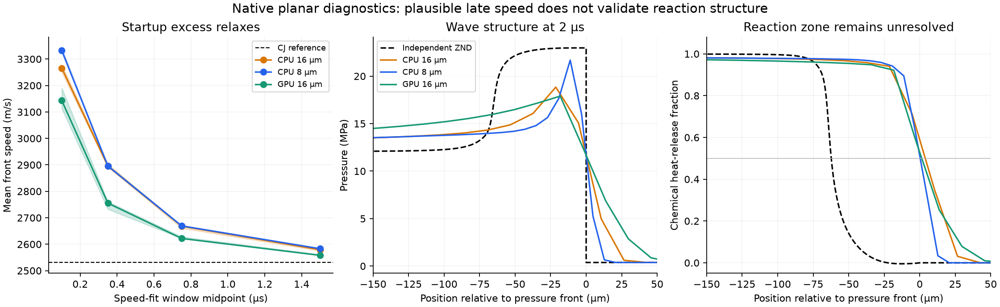

# Why the native prototype fails: diagnostic campaign

October 25, 2026, branch `3d-modelling`. The campaign attempted **32 native runs**: 31 reached their requested end times; one tighter-chemistry control stopped at an ODE integration limit. Tests used one H100 and one separate 16-core CPU worker, with per-case limits. [Exact inputs, checks and timings](index.json) · [Reproduce](REPRODUCE.md). The engine prototype remains unvalidated; these tests diagnose specific failures.

## What the annular controls establish

All comparisons below run to **1 µs**, close the outlet, and change one setting at a time. Frozen chemistry means species still move, but reactions are disabled. Chemistry-only means each cell reacts without fluid transport.

| Control | PeleC | Unmodified detonationFoam |
|---|---|---|
| Chemistry off, injectors closed | Species bounds/closure pass | Local species sum reaches 1.12157 |
| Chemistry off, injectors open | Species bounds/closure pass | Sum reaches 1.12543 |
| Reacting, injectors closed | Negative species; mass rises 0.0344% | Sum reaches 1.12538 |
| Same case, timestep 20 → 5 ns | Worst negative falls from −6.18×10⁻⁴ to −4.87×10⁻¹⁰ | Sum error remains 12.93% |
| Chemistry only | Bounds pass; mass conserved to roundoff | Not included in this batch |
| Remove startup charge | Bounds pass | Sum error remains 12.57% |
| Cold injection into fresh gas | Bounds/closure pass | Bounds/closure pass |

**PeleC:** isolated chemistry and frozen transport work over this window, but their coupling around the strongly disturbed startup state fails. A 1 ns timestep passes every-step species bounds; closed mass still rises **8.35×10⁻⁷ relative**. It costs 383 seconds of integration for 1 µs. Removing the charge's tangential velocity does not cure negativity. The worst saved negative species is CH3 in a regular cell near the inner wall; this does not exclude effects from nearby embedded-boundary cells.

Turning off embedded-boundary cleanup restores mass conservation to roundoff but worsens negative species. The pinned [cleanup implementation](https://github.com/Pele-Suite/PeleC/blob/949e2bb67386bf4b16324b06555e303ff411e179/Source/Utilities.cpp) clips species densities and recomputes total density. This is a demonstrated conservation/positivity tradeoff in this setup, not a complete repair.

**detonationFoam:** closure fails without chemistry and without the startup charge. Neither smaller timesteps nor ordinary upwind species interpolation cures it. The upstream [species equation](https://github.com/JieSun-pku/detonationFoam/blob/4bd2e86003447fdb143b475f199c846146f754e3/applications/solvers/detonationFoam_V2.0/solverTypeEuler/rhoYEqn_Euler.H) builds convection using volume flux `phi`, then transports using mass flux `rhoPhi`. Kurganov's density-diffusion contribution allows their signs to differ. A separate executable tests the one-line change to use `rhoPhi` consistently. In the unseeded annulus, this reduces the species-sum error from 12.57% to 1.75×10⁻¹² and reduces clipping to roundoff. With the strong startup charge, corrected flux plus upwind interpolation eliminates significant non-inert clipping, but leaves a maximum species-sum residual of 6.11×10⁻⁸ (the check requires <10⁻⁸). Corrected flux with the original limited-linear scheme still clips and leaves about 1.1×10⁻⁴ closure error. Tightening chemistry from abs/rel 10⁻¹⁰/10⁻⁶ to 10⁻¹²/10⁻⁸ exhausts the native 10,000 ODE-step limit at the step to 0.10 µs; the last completed step is 0.08 µs. These are improvements and diagnosed limits, not a complete engine fix. The repaired short planar wave has exactly the original speed, separating the transport defect from the propagation transient. Upstream baselines remain available.

## Propagation and other physical checks

The earlier 0.2 µs planar speed fit sampled the initial transient. The extended test uses **2 µs**, a **32.768 mm** domain, an independently reintegrated ZND tail, and characteristic bounds to check boundary isolation. On the 16 µm CPU grid, speed falls from about **3,266 m/s at 0–0.2 µs to 2,579 m/s at 1–2 µs**, versus **2,531 m/s CJ**. Speed is measured using three pressure thresholds and multiple time windows. The 8 µm CPU run gives 2,583 m/s over the same late window (0.14% difference); PeleC at 16 µm gives 2,558 m/s. All three collapse the 50% chemical-progress position into the numerically captured shock, instead of retaining the reference's 62 µm separation. The speed agreement does not validate the reaction structure. PeleC's longer run also misses the strict local element-ratio tolerance (9.1×10⁻⁷), while its integrated elemental ratios remain conserved to about 10⁻¹⁴. This is distinct from the global mass drift in the annular cleanup test.

Short CPU refinement from 8 → 4 → 2 µm gives approximately 3,328 → 3,387 → 3,474 m/s over the final 0.1 µs; halving the original timestep barely changes the answer. Refinement alone does not explain away the transient. The few-ppm common-reference element discrepancy is largely associated with OpenFOAM/Cantera molecular-weight differences (up to 2.98×10⁻⁵ relative), separately audited without waiving the original check.

A **nonreacting moving material contact** should preserve uniform pressure and velocity. PeleC preserves species bounds but produces up to 8.1% pressure error at saved times (9.5% in every-step maxima), and 17.8 m/s velocity error. This exposes a mixture-interface artifact independently of chemistry. Such pressure errors are a known multicomponent discretization problem; their impact here still needs refinement tests. [Abgrall, 1996](https://doi.org/10.1006/jcph.1996.0085).

## Resolution, ignition, and what to test next

The 595 µm GPU annular mesh is exploratory. [Argonne's CONVERGE study](https://doi.org/10.2514/6.2021-3642) used about 188 µm near the wave; [NETL's study](https://netl.doe.gov/projects/files/ValidationofaComputationalFluidDynamicsModelofaMethaneOxygenRotatingDetonationEngine_010522.pdf) compared 400, 200, 100 and 70 µm, with a different wave count on the coarsest mesh. These are model-dependent engineering resolutions, not proof of resolved chemistry. Our reference reaches half heat release about 62 µm behind the shock; its sharp 50–95% heat-release region is only about 11 µm. An 8 µm planar grid barely samples that sharp region. The current annular model also omits molecular diffusion, turbulence modelling, injector channels/plenums, wall heat loss and downstream core expansion.

Opposed radial jets are one injector design, not a universal RDE arrangement. **72 pairs is fixed from Mundt's 76-FI-5 / Run 937 benchmark**, not queried from live CAD. The separate CAD audit also found 72 pairs but did not certify the latest CAD revision. Mundt's hardware ignites through a separate spark-ignited pre-detonator (printed pp. 26–28 of [the thesis](../../../Mundt2023.pdf)); Argonne explicitly simulated a pre-detonator startup. Our finite hot moving charge is a propagation/startup surrogate. Its 1900 m/s gas velocity does not prescribe detonation speed, and successful motion would not validate ignition or natural direction selection.

Next physical milestones: consistent/conservative mixture transport; planar-wave convergence over longer windows; cold injector mass flow and mixing; pressure-pulse feed interruption/refill; startup-energy/direction sensitivity; then several annular revolutions with coupled shock/heat-release tracking. At this radius, one revolution takes roughly 0.09–0.12 ms at representative wave speeds. Millisecond engine runs become useful after these controls are credible.

## October 26 clarification: paper startup and practical next step

The original detonationFoam local species-sum excess of about **12.5%** is substantial. The corrected-flux/upwind residual of **6.11e-8** is only **0.00000611%**. Its failure of the deliberately strict 1e-8 check is not comparable in physical significance; that residual alone should not block an engineering prototype. Longer-run growth and conservation still need monitoring.

The two existing reference studies use different numerical ignition procedures:

| Setup | Numerical startup |
|---|---|
| [NETL / Fluent, section III](https://netl.doe.gov/projects/files/ValidationofaComputationalFluidDynamicsModelofaMethaneOxygenRotatingDetonationEngine_010522.pdf) | First 5 mm: stoichiometric mixture at 1 MPa; air beyond, with pressure tapering to 0.1 MPa at exit. Initialize a 2-degree sector at 4 MPa and 3000 K. No tangential velocity kick is specified. |
| [Argonne / CONVERGE, section II](https://doi.org/10.2514/6.2021-3642) | Establish nonreacting feed with the pre-detonator disconnected; spark the premixed tube, model transition to detonation, briefly connect it to the annulus, then close the interface. |
| Our existing prototype | Large finite hot charge at 10 MPa and 4000 K with imposed 1900 m/s tangential gas velocity. This is our surrogate, not a reproduction of either paper's ignition. |

The next proposed engine configuration should follow NETL's stated initialization, remove our imposed tangential kick, and reduce annular cell size toward approximately 200 micrometres, with a finer comparison near 100 micrometres. These are proposed changes, not implemented results. Matching initialization alone will not reproduce the paper: injector/plenum geometry, transport, turbulence, boundary conditions and chemistry also differ. Any values the paper does not specify must remain explicit assumptions.

Refinement means actually decreasing cell size and comparing the resulting propagation and structure. The previous 4/2 micrometre planar tests were too short to establish settled mesh convergence. They do not demonstrate that refinement cannot work. Engineering annular wave-count/speed convergence and detailed planar reaction-layer resolution are separate questions; the latter should not become an indefinite prerequisite for an exploratory engine run.

Two GPUs are now authorized. The current archived PeleC build has MPI disabled: sharing one engine across both GPUs requires an MPI-enabled build, domain decomposition and a scaling check. Independent one-GPU cases can already run concurrently. No new solver calculation was launched for this review.

[New animation of the existing 0–2 microsecond planar control](long_planar_visual/long_planar_propagation.gif) uses all 21 saved native snapshots without temporal interpolation. The [existing 0–10 microsecond annular animation](../3d_prototype_20261024/pelec_visual/pelec_annulus.gif) remains the longest available annular result; it does not establish sustained rotation. The planar replay is longer than the original 0.2 microsecond planar test, not longer than the annular run.
