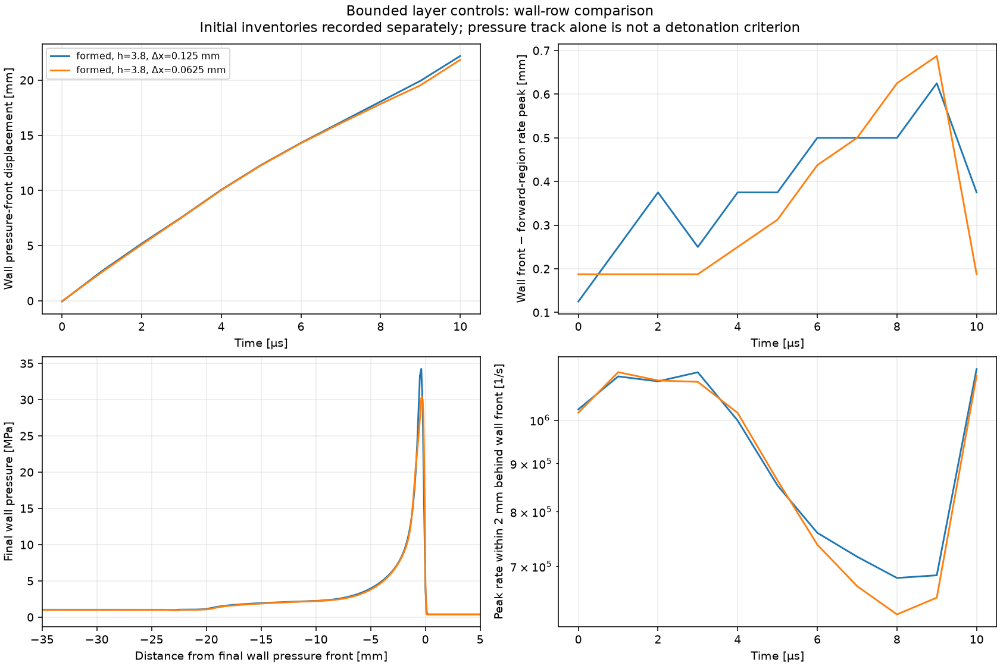

# C5b–e quarter-length reaction experiment

October 22, 2026. Predeclared protocol: [controlled plan](../plans/controlled_2d_tests.md).
Status: C5b–e bounded experiment completed. Both layer meshes retain near-wall/middle shock-associated reaction through 10 us. C6 not launched; RDE-001 remains open.

The independent investigation correctly motivates testing a shorter surrogate.
Its confirmed-root-cause, universal h/L50 threshold, outlet timing and 12x source
step slack claims are not adopted. The original plan permitted this sensitivity;
this increment makes that option concrete. C6 remains gated.

Selected L50=0.25 mm, k=4 times baseline, unchanged activation energy and EOS.
Production defaults and previous runs remain unchanged. Initial reactor/planar/
contact gates precede the 10 us, two-grid, 3.8 mm formed-layer experiment.
The current SSP-RK2/source-slope cap is retained. Full-scale physical chemistry,
GPU work and an engine run are outside this experiment.


## Implementation and verified prerequisite results

`short_reaction.py` creates a copied calibration with k=10,089,856.546/s,
L50=0.25 mm, L90=0.784987 mm and L95=1.044317 mm. Other constants are unchanged.
It gates the layer pair on saved verification status, calibration and source
fingerprints. `controlled.py` accepts an explicit remote-domain scale and records
it; default C1–C4 behavior is retained, and continuation must preserve the scale.
No production solver, source integrator, default configuration or calibration changed.

- Profile jump residuals: maximum 7.46e-13; independent quadrature confirms
  L50, L90 and L95. Conservative profile states are unchanged by the rate rescale.
- Cold/warm/shock-heated homogeneous reactors: maximum progress error 7.62e-6
  at source fraction .05, decreasing approximately fourfold at .025. Total
  energy is unchanged; zero invalid states. Tightening DOP853 tolerances changes
  the reference by at most 2.29e-10.
- Filled strips through 10 us: late (5–10 us) speeds 2478.153/2472.973 m/s
  at 0.125/0.0625 mm versus model CJ=2471 m/s. Coarse half-source-step speed
  is also 2478.153 m/s. Shock/reaction separation at the endpoint is
  0.375/0.1875 mm; all source/grid cases retain near-front reaction. Maximum
  budget residual <2e-14, zero invalid states, positive causal margins.
  These are surrogate numerical checks, not independent validation of fitted CJ.
- Moving contact through 5 us: reactive conversion 181.745/114.582 J/m2 at
  the two meshes; frozen conversion is zero. Contact burning is still numerical
  and mesh dependent. This decrease is not an engine-loss bound or convergence.

Metrics and full histories: [verification](c5_short_verification.json).
Original stopped gate: [preserved record](c5_short_initial_gate.json).
Raw fields stay under ignored `runs/c5_short_verify*` directories.

## Issue encountered and corrected

The initial reactive-contact gate required the far-field pressure to remain at
its initial value. It stopped at a relative change of 1.426476e-6. Independent
homogeneous integration predicts 1.426476e-6 from the model's nonzero 300 K
Arrhenius reaction. This was an incorrect diagnostic assumption, not evidence
of a reflected disturbance or unstable solver. Comparing pressure, density,
velocities and progress against that evolving reference gives <2.2e-15 scaled
error. A deliberately perturbed saved boundary fails the new check.

The initial failure remains recorded. The corrected verification reused the three
completed planar and two completed contact runs after matching inputs and all
simulation-source hashes; only the missing fine contact pair advanced CFD.
No timestep, chemistry, flux or numerical tolerance was relaxed. Two test-command
invocations initially used the repository root instead of the documented starter
working directory; rerunning from the starter fixed those invocation errors.

## Tests and layer execution protocol

- Focused harness/import checks: 17 passed, 23.6 s (`c5_short_tests.log`).
- Regression suite before the contact-gate correction: 77 tests, 76 passed and
  one opt-in reactive baseline skipped, 75.4 s (`c5_short_full_tests.log`).
- After the diagnostic correction: five focused tests passed, including the
  independent reactor and injected boundary-error check (`c5_short_gate_tests.log`).
- Actual corrected reactor/planar/contact diagnostic gates all passed.

The layer pair uses four Numba threads on the eight-logical-CPU, 16 GB host;
verification used two. This only changes execution parallelism. The fixed local
model, 3.8 mm layer, 0.125/0.0625 mm meshes, 10 us cap, causal bounds and conserved
initialization are predeclared in the plan. No automatic engine run follows.
The coarse/fine domains have about 261,000/1,045,800 cells. The source cap is
about 3.61 ns, so each takes about 2,770 steps. Completed outcomes are recorded below.


## Additional interpretation checks during execution

A ten-step discrete scale-similarity check compares a 15 mm / 0.5 mm model with
its fully scaled 3.75 mm / 0.125 mm counterpart, including all remote dimensions
and k times four. Primitive states agree to 5.78e-11 after ten steps, the elapsed
time ratio is exactly four, and neither run has invalid states. See
[c5_short_similarity.json](c5_short_similarity.json). This verifies the scaling
argument, not the actual 3.8 mm layer outcome or an engine configuration. Its first
invocation required the normal repository permission because Numba's cache cannot
be initialized under the stale workspace sandbox; the permitted invocation passed.

Independent steady-profile quadrature gives 0.5653 us to half heat and 1.4306 us
to 95% heat for the shortened model. The illustrative original-layer h/a_VN
scale is 4.1580 us. This makes the reaction/relief hypothesis plausible but is not
a sufficient extinction or survival criterion. L95 remains about 20 times the
physical D3 reference; shortening k's timescale has not validated physical chemistry.

The output clock retains a roundoff-separated final snapshot at 10 us. The raw
histories are preserved; quantitative postprocessing keeps the last member of
pairs separated by less than 1 ps (versus the 1 us layer output cadence). Using
unique samples and an inclusive 5–10 us fit, planar speeds are
2472.727/2471.591 m/s, with 2472.727 m/s for the half-source-step control. The
raw verifier values above use its original window/endpoint selection. Both
versions pass the predeclared speed gates. This is a sampling-weight correction,
not a change to the solver or a reason to rerun the flow.

The coarse layer has completed: top-state changes are zero apart from an axial
velocity perturbation below 1e-150 on its reference scale. Near-wall/middle
reaction remains close to the front, but the wall pressure rises sharply late
in the window; the endpoint is transient. This was the interim coarse assessment; both completed results follow.


## Completed two-mesh result

Both cases completed 10 us / 2,771 steps with zero invalid states and positive
causal margins. The endpoint top margin is 0.5 mm; the top four rows retain
initial pressure, density, transverse velocity and progress exactly, with only
negligible axial-velocity tails. Maximum characteristic speeds are below the
predeclared 4000/3200 m/s limits (fine: 3515.1/3101.7 m/s). Native endpoint
integrals agree with the saved conserved checkpoints. The two meshes have the
same initial conserved inventory and 4389.637 J/m excess energy to roundoff.

| Measurement | 0.125 mm | 0.0625 mm |
|---|---:|---:|
| Maximum scaled budget residual | 5.91e-16 | 1.77e-15 |
| Wall-row final pressure maximum [MPa] | 34.249 | 30.379 |
| Wall-row front–rate-peak gap [mm] | 0.375 | 0.1875 |
| Wall-row near-front peak rate [1/s] | 1.134e6 | 1.115e6 |
| Middle-row front–rate-peak gap [mm] | 0.500 | 0.4375 |
| Middle-row near-front peak rate [1/s] | 7.286e5 | 6.992e5 |
| Upper sampled-row front–rate-peak gap [mm] | 1.375 | 1.9375 |
| Wall-row pressure-front speed, 4–10 us fit [m/s] | 1977.7 | 1910.7 |
| Middle-row pressure-front speed, 4–10 us fit [m/s] | 2098.2 | 2044.6 |
| Total converted chemical energy [J/m depth] | 1830.618 | 1759.464 |
| Measured wall-clock time, four threads [s] | 420.8 | 1245.2 |

Pressure/rate histories and full fields jointly show continuing near-front
reaction near the wall and middle on both meshes. Upper-layer coupling is weaker.
The wave slows during part of the interval and develops a late near-wall
transverse interaction with a strong pressure/reaction pulse. Thus the final
30–34 MPa peak is a transient, not an operating pressure or proof of stability.
The 6–10 us wall-speed fits are 1950/1856 m/s; the 8–10 us fits rise to
2063/2000 m/s, confirming window sensitivity. These threshold-track speeds must
not be presented as settled detonation speeds or matches to Mundt.

Refinement changes total conversion by 3.89%, wall endpoint pressure by 11.3%,
and the 4–10 us wall speed by 3.39%. The upper-layer pressure/structure differs
more strongly. This is qualitative agreement in bounded coupling, not numerical
convergence. Conservatively averaged initial mixed-row temperatures are
616.65/350.16 K despite identical total inventories; evolving contact burning
remains visible. The native diagnostic heights differ slightly between meshes
and are retained in the metrics. No initial-interface sensitivity was silently
removed or confused with a pure cell-size change.

**Decision:** the selected shorter surrogate passes this bounded experiment.
The result supports the reaction-length/finite-layer hypothesis; it does not
confirm a unique cause of the failed original engine run. Compared with the old
C3 controls, physical grid spacing and remote geometry also changed, and those
older cases ran 40 us rather than 10 us. Do not describe this as a same-grid,
same-window chemistry-only A/B test. The independent similarity check and
within-model mesh/source checks provide the supporting numerical evidence.

The initial formed charge remains substantial, and 10 us cannot prove eventual
survival. No injection, periodic rotation or engine outlet is present here.
RDE-001 and physical Run 937 validation remain open. The surrogate EOS and
physical reaction-profile mismatch are unchanged; this is not a fitted physical
mechanism or a replacement of the baseline default calibration.

## Gate review and concrete next increment

No critical implementation, source-accuracy, admissibility or causal-domain
inconsistency was found in this bounded comparison. Spatial/contact/transient
qualifications remain explicit. The next increment is **C6a: conservative formed
engine initialization plus a short, explicitly labelled cost/validity benchmark**,
keeping the selected chemistry fixed. Test the periodic seam, conserved initial
charge/momentum/energy and restart/budget behavior before advancing the engine.
Start with a 2 us benchmark at 0.125 mm, then estimate the existing three-interval
run cost from measured steps/throughput; do not promise runtime from GPU estimates.
If source integration materially limits that run, improve and verify it as a
separate numerical change before the longer engine comparison.

This refines the earlier protocol's suggestion to require another longer layer
run before C6. A 20 us causally buffered two-grid layer rerun would add roughly
an order of magnitude in cell-step work without testing engine replenishment.
The successful bounded gate justifies a bounded engine experiment, while claims
of steady operation still require longer evidence. A longer layer control stays
available for a specific ambiguity; it is not an automatic extra sweep. No rate,
height or ignition-energy tuning follows from the endpoint pressure.

## Reproduction and verification record

Native cases: `rde_sim_starter/runs/c5_short_layers/layer_0.125` and
`layer_0.0625`. [Metrics and provenance](c5_short_layer_metrics.json) include
source fingerprints, file hashes, histories, mixed-row temperatures, top-state
checks and speed windows. Reduce saved files from the repository root with:

```sh
.venv/bin/python docs/verification/c5_short_reduce.py rde_sim_starter/runs/c5_short_layers /tmp/NEW_metrics.json
```

The final regression suite ran **78 tests: 77 passed, one opt-in baseline
skipped**, in 113.955 s (`c5_short_final_tests.log`). The additional ten-step
similarity check passed. Final plot-only edits correct the compact-domain legend
and generic case labels; the coarse, fine and comparison renders were inspected.
No further simulation was run for rendering or postprocessing.



[Coarse fields](c5_short_layer_coarse.png) · [Fine fields](c5_short_layer_fine.png).

Final saved-data audit passed: matching frozen calibration/source fingerprints,
completed endpoints, positive causal margins, unchanged output hashes, eleven
unique layer snapshots, equal initial inventories and checkpoint integrals.
