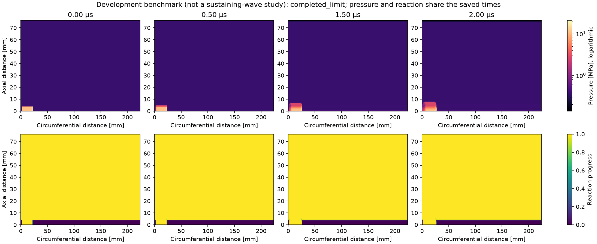
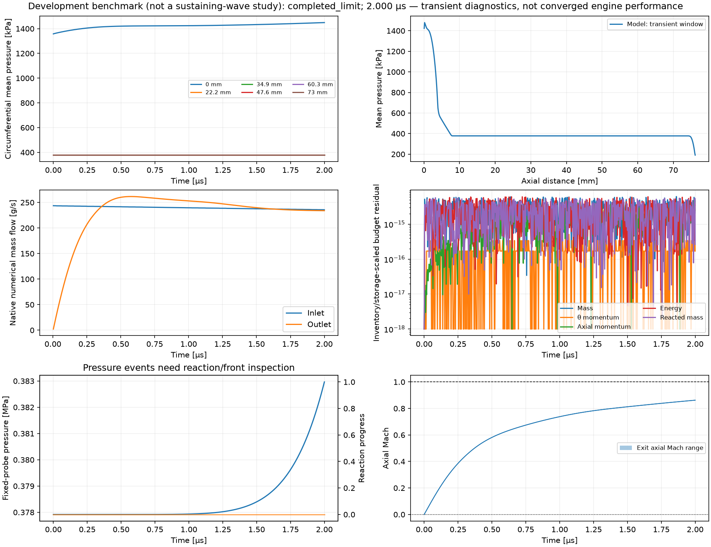

# C6a: formed initialization, bounded benchmark and test review

October 22, 2026. Functional 2D work on **main**. The user's latest direction
assigns the sustained-wave study to a separate chat. This increment implements
planned initialization and execution/reporting features; it does not run a
three-interval engine study or tune the physics for sustained rotation.
[RDE-001 remains open](run937_unresolved.md).

## Implemented behavior

`initialization.kind: formed` places one finite, +theta ZND charge in the
initial 3.8 mm fresh layer. Conservative cell averages include fractional axial
cells and cells crossing the periodic seam. Momentum is in laboratory
coordinates (`D_CJ - u_shock_frame`); energy already includes unspent chemical
energy, so no additional ignition heat is added. Saved inputs record all five
inventories, the independently integrated profile inventory, remaining chemical
energy and excess energy over the unignited layer.

The named case is `cases/run937_formed_lhalf_0p25mm.yaml`, with its matching
calibration JSON. It retains Run 937 reduced geometry/inlet/outlet and the
verified C5 quarter-length **surrogate**, using a requested 0.125 mm mesh.
The finite charge is 20 mm long, its shock at 10% of the circumference.
This is a declared startup choice, not Mundt's physical pre-detonator. The
burned-to-fresh return at the rear of the charge is an explicit pressure/velocity
jump; the fresh-layer/hot-product contact also remains. Neither is a hidden
periodic-seam artifact or a claim of a steady periodic ZND solution.

The common profile utilities moved unchanged from `controlled.py` to `formed.py`;
old controlled callers retain their imports. This avoids importing the diagnostic
driver into the production runner. `formed.py` participates in restart source
fingerprints. Existing historical checkpoints still require their original
source/environment; saved-data analysis remains available without restarting them.
The flux, EOS, reaction source, integration scheme and baseline case are unchanged.

`--benchmark-us` is an explicit development mode with a maximum duration of
2 microseconds. Its cap and mode are saved in inputs, summary and plot analysis.
An interrupted benchmark resumes to its saved cap; it cannot be converted into
an engine passage study by a resume flag. Ordinary runs retain the three/five
reference-interval limits. Benchmark plots identify their scope and omit the
experimental long-window mean overlay.

## Three implementation reviews and test audit

1. **Construction/inventory review.** Wrapping an infinite profile would hide a
   return discontinuity. Use a finite, explicitly recorded charge, conservative
   integrals and fractional layer coverage. Verify the whole-domain integral
   over multiple meshes/phases, independent quadrature of seam-crossing cells,
   and normal-shock momentum/energy identities independent of the ZND solver.
2. **Failure-detection review.** Existing source tests use independent exact or
   DOP853 solutions; boundary tests use analytical fluxes; restart tests compare
   saved fields/budgets. Those are useful checks, but do not prove engine-wave
   stability. Found and fixed a genuine fail-open diagnostic check:
   `short_reaction.require_run` used only `error > tolerance`, which accepts a
   numeric NaN (and a negative error). It now requires a finite, nonnegative
   residual within tolerance. A mutation test supplies NaN, infinities, negative
   and excessive residuals, failed status and invalid-state counts. Historical
   saved C5 residuals were finite and positive; this gap is not evidence that the
   previous pass was false or the cause of the engine failure.
3. **Restart/scope review.** Existing runner replay mainly exercised disabled
   chemistry. Add a reactive formed-charge run with injected bookkeeping failure,
   recovery from an earlier checkpoint, and exact comparison against a separate
   uninterrupted run (fields, all native flux/source accumulators, history and
   averages). Also test refusal of changed numerical fingerprints, incompatible
   benchmark/passage flags and invalid inputs. Shift the wave across the seam
   and advance several steps: fields must translate, periodic net flux must
   cancel, and integrated injector/outlet fluxes must agree.

Issues caught while developing this increment: the first test invocation used
the repository root without the documented module path; rerun from
`rde_sim_starter`. The new tests caught a missing initializer dispatch, which was
wired into `build_solver`. The independent normal-shock comparison differed by
2.32e-12 relative due to the existing scalar root solve; its check is 1e-10,
still far tighter than CFD discretization errors. A new seam test initially
compared individual cut-plane fluxes after translating the wave. That expectation
was wrong: a different location samples a different local flux. Corrected the
assertion to check left/right cancellation per run and unchanged integrated
physical inlet/outlet fluxes. The field translation test already passed.

Visual inspection caught one reporting issue that the file-existence plotting
tests did not detect: a circumferentially uniform exit has identical minimum and
maximum Mach numbers, so a shaded range alone is invisible. The plot now also
draws both range boundaries. The numerical Mach records were present and correct;
this was a display gap, not evidence of an inactive outlet. The saved plots were
regenerated and inspected after this correction. Space–time plots are also
clipped to their saved time range so nearest-sample bins do not imply data
before startup or beyond the 2 us endpoint.

## Reproduce

From `rde_sim_starter`, with the existing environment:

```sh
NUMBA_NUM_THREADS=2 ../.venv/bin/python -m unittest discover -s tests -v
NUMBA_NUM_THREADS=4 ../.venv/bin/python run.py \
  --case cases/run937_formed_lhalf_0p25mm.yaml \
  --calibration cases/run937_formed_lhalf_0p25mm.calib.json \
  --benchmark-us 2 --out runs/c6a_formed_benchmark
../.venv/bin/python plot.py --run runs/c6a_formed_benchmark \
  --out runs/c6a_formed_benchmark/plots
```

All output directories must be new. Use `run.py --resume <directory>` for an
interrupted benchmark, preserving its saved cap. Do not supply `--test-passages`.

## Results

Regression: **85 passed, one opt-in long baseline skipped** in 56.129 s.
After the final reporting change, all four saved-output/import tests passed in
101.381 s, including one new benchmark-label test. That is **86 distinct passing
tests and one opt-in skip** across the two runs. Logs: [full suite](c6a_tests.txt)
and [final output tests](c6a_output_tests.txt). CLI usage errors in the full log
are deliberate invalid-option checks. Matplotlib deprecation/empty-legend
warnings do not invalidate numerical checks.

The full-size initial state has 1789 × 610 = 1,091,290 cells. Actual spacings are
0.125032 mm circumferentially and 0.124918 mm axially. One mixed axial row
represents the 3.8 mm interface. The independently integrated inventory agrees
within 2.38e-15 scaled error. Initial mass is 8.21361011e-5 kg, total energy
239.262691 J, and unspent chemical energy 84.7860061 J. The formed charge adds
11.7934203 J relative to the unignited layer. This is neither the old 5.03 J D1
hot patch nor an equal-energy comparison to it. The rear jump is at 2.36814 mm,
the shock at 22.36814 mm; the periodic cut lies in fresh gas within the lower layer at startup.

The benchmark **completed 2 us in 556 accepted steps**, with zero invalid
states. Independent reduction of the float64 checkpoint gives a maximum scaled
conservation error of 2.66e-15; the entire native history stays below
6.18e-15. All 557 native records are consecutive and strictly increasing;
checkpoint, summary and final history times agree. The reaction source changes
reacted mass with exactly zero entries for mass, momentum and total-energy source.
Final progress extends above one by roundoff only (maximum endpoint value
1.0000000000000009), within the existing declared tolerance; no clipping is added.

Measured execution took **441.0 s (7.35 minutes)** using four CPU threads,
including saved-output work after initialization. The grid advances about
1.38 million cell-steps/s. Several other processes were active and throughput
varied substantially, so this is a shared-machine cost observation, not an
isolated benchmark. A linear extrapolation to three reference intervals is
**11.6 hours** at this measured rate; it is neither a runtime guarantee nor an
authorization to launch that study here. Native output before plots is about
5.99 MB compressed. The cap remains 2 us.

[Machine-readable evidence and source/input hashes](c6a_metrics.json) and the
[read-only reducer](c6a_reduce.py) retain the measurements. Native fields and
checkpoints remain in `rde_sim_starter/runs/c6a_formed_benchmark` (ignored generated
results). The accompanying figures show saved fields and functional budgets;
they do not establish sustained rotation, a converged engine mean or agreement
with Mundt's measured wave behavior.

[Saved circumferential rings](c6a_space_time.png) and [plot reduction](c6a_plot_analysis.json).




## Next functional increments

Continue the master plan's saved-result/reporting and force-accounting work:
first an explicitly selected time-window report using native budgets and the
annulus-exit force definition, then a minimal geometry/result contract with
unsupported-geometry rejection. Verify each with analytical/synthetic data and
small nonreacting/reactive plumbing tests. No new wave-survival sweep, source
integrator replacement, 3D/GPU work or friction tuning is scheduled here.
Physical-validation gates remain attached to claims, not to every functional
feature. The separate sustaining-wave study owns the next propagation decision.
