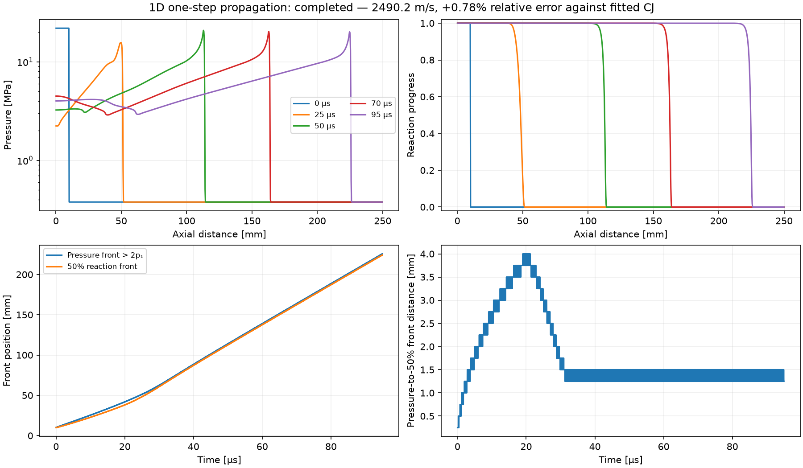
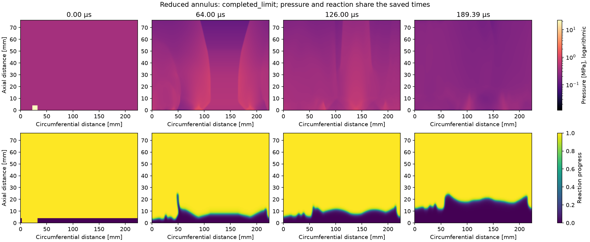
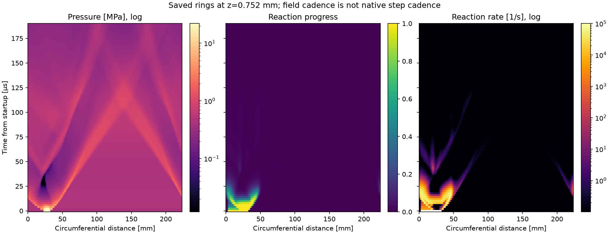
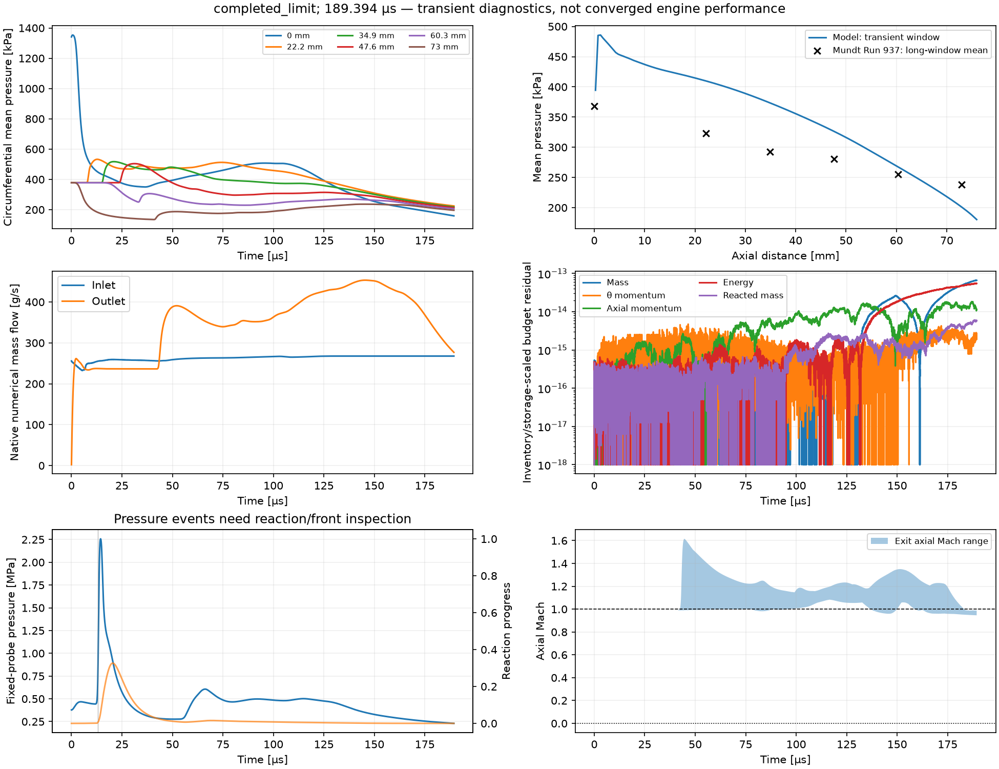

# D1 source accuracy and first propagation results

October 21, 2026. This increment follows the foundation and D0 commits through
`5ed8aa7`. The inherited one-step chemistry and calibration were held fixed.

**Outcome:** the 1D shock and reaction fronts propagate together, with a measured
speed of 2490.157 m/s (+0.7753% against the fitted 2471 m/s surrogate CJ reference).
The first 2D Run 937 case completes its 189.394 µs cap without invalid states,
but its pressure fronts weaken and the saved fields do **not** demonstrate a
sustained rotating detonation. Reaction persists at the fresh/product interface;
this is not evidence that all chemistry has extinguished. No five-interval
extension or chemistry retuning was performed.

The current open-case status and investigation criteria are maintained in
[RDE-001](run937_unresolved.md). Passing the numerical checks here does not satisfy
the broader plan's sustained-wave milestone.

## What changed

- A source-resolution cap supplements the flow CFL for explicit SSP-RK2.
- Progress validation tolerates and records float64 roundoff without changing
  conserved values. Significant invalid states still reject the step atomically.
- The equivalent converging injector uses a consistent opening-plane state and
  pressure forces on both open and closed face areas.
- A bounded 1D driver saves fields, front histories and conservation metrics.
- Engine snapshots include reaction rate and temperature. Native history includes
  fixed-probe pressure/progress/temperature and field extrema.
- Saved-run plotting produces pressure/progress fields, a pressure/progress/rate
  space–time ring, and transient diagnostics. Missing reaction-rate fields in older
  runs are labeled unavailable. Plotting never advances the solver.

## Reactive-source check

At constant density and total energy,
`T = T0 + A*(xi-xi0)`, with `A=(gamma-1)*q/R` and `B=Ea/R`.
For the source `f=(1-xi)*k*exp(-B/T)`, a conservative global bound is

`|df/dxi| <= k*(1 + 4*exp(-2)*A/B)`.

It follows by bounding depletion separately and maximizing
`exp(-B/T)*B/T^2` at `T=B/2`. The implementation includes the tiny permitted
progress excursion in the heating bound and uses `k` directly when `Ea=0`.
The source step is `source_cfl / bound`; production cases require a positive
fraction no greater than 0.25. The default **0.05 gives 14.454733 ns** for this
calibration. This bound is deliberately conservative and is not an error estimator.
It changes neither physical coefficients nor reaction length with the mesh.

An independent SciPy DOP853 scalar constant-energy ODE, with `rtol=2e-12` and
`atol=2e-14`, supplies the reference. Maximum absolute progress errors are:

| Initial state and interval | Fraction 0.10 | Fraction 0.05 | Fraction 0.025 |
|---|---:|---:|---:|
| 1000 K, xi=0, 30 µs | 3.0375e-5 | 7.6200e-6 | 1.9083e-6 |
| 2116.249 K, xi=0.35, 6 µs | 9.1285e-6 | 2.2815e-6 | 5.7028e-7 |
| 300 K, xi=0, 10 µs | 1.62e-21 | 1.87e-21 | 7.21e-22 |

Active cases show approximately fourfold error reduction when the step is halved.
The cold case remains almost unreacted and is not a meaningful order estimate.
Total-energy error is zero in these uniform source-only tests: energy already
contains the unspent chemical reservoir, so reaction changes `rho*xi` without a
second energy source. Full measurements and environment hashes are in
[d1_source_metrics.json](d1_source_metrics.json).

The first strict 1D attempt stopped at `xi=1.0000000000000002`. The allowed
progress tolerance is now **64 float64 epsilons = 1.4211e-14**, with no write-back,
clipping, state floors or repair. The rate is zero for slightly super-unity
progress; significant overshoot remains an error. Tests reject a 1e-10 overshoot
and verify the original conserved array remains untouched at tolerated roundoff.

## Boundary check

Previously the injector combined choked mass flow with a velocity expanded all
the way to chamber pressure. A converging opening now uses `p_jet=max(p_wall,p*)`
and its corresponding isentropic temperature/velocity; it is sonic when choked.
Mass, transmitted momentum and enthalpy use that same plane. The face-normal
momentum flux includes `sigma*p_jet + (1-sigma)*p_wall`. A blocked injector has
zero mass/energy flow and retains the full pressure load.

This follows the ideal converging-nozzle and isentropic relations described by
[NASA's isentropic-flow reference](https://www.grc.nasa.gov/www/k-12/airplane/isentrop.html)
and [mass-flow/choking reference](https://www.grc.nasa.gov/www/k-12/BGP/mflchk.html).
The inherited discharge coefficient 0.76 scales transmitted flow; pressure uses
nominal open area. This is a declared effective closure, not a validated resolved
injector. Separate fuel/oxidizer mixing and backflow remain unresolved.

Tests check sonic and subsonic opening states, stagnation enthalpy, whole-face
fluxes and blocked behavior. The outlet test confirms that its pressure selection
uses **axial Mach**, including when azimuthal speed is large. It does not validate
the inherited subsonic pressure closure or its response to reverse flow.

## 1D propagation with fixed chemistry

The 250 mm tube has 1000 cells (0.25 mm), a reflecting left wall and transmissive
right boundary. A 10 mm product patch starts at twice the fitted CJ pressure;
the rest is fresh gas at the saved reference state. Both runs end at 95 µs.
Front speed is a linear fit after 40 µs to the last cell above `2*p1`; the reaction
front is the last cell at `xi>=0.5` behind it. These are grid-level operators.

| Quantity | Default source fraction | Half source fraction |
|---|---:|---:|
| Source fraction | 0.05 | 0.025 |
| Accepted steps | 6574 | 13148 |
| Front speed | 2490.156879 m/s | 2490.179044 m/s |
| Relative difference from fitted CJ | +0.775268% | +0.776165% |
| Final pressure-to-50% front distance | 1.25 mm | 1.25 mm |
| Invalid states | 0 | 0 |

The speed difference is **0.022165 m/s**, about **0.000890%** of the default
speed. Maximum progress excursions are 2.22e-16. Conservation residuals are
near roundoff; exact values and normalization are in the metrics file.
This supports temporal accuracy for this experiment. It is not spatial
convergence, detailed-chemistry validation, or an independent validation of the
CJ speed used to fit the surrogate.



## First 2D Run 937 record

The saved case has 447 × 152 cells, actual spacings 0.500406 × 0.501316 mm,
76.2 mm axial length and 223.681 mm mean circumference. It uses the existing
3.8 mm fresh fill, one 10 mm ignition patch at twice CJ pressure, 20 mm product
region behind the patch, corrected plenum boundary and fixed chemistry.
The saved initialization energy change is +5.0265 J relative to its specified
fresh/product baseline; that is not a measured igniter energy.

The run completed **13,165 steps**, **96 snapshots** and **13,166 native history
rows**, ending at **189.393939 µs**. This is three intervals of the experimental
15.84 kHz reference used only to budget duration. It is not three observed waves.

- Invalid-state count: **0**; largest recorded progress excursion: **6.66e-16**.
- Maximum conservation residual across the native record: **6.69e-14**, normalized
  componentwise by the greater of initial inventory and maximum storage change.
- The final maximum pressure is **0.450731 MPa**, down from the imposed initial
  peak of 21.9031 MPa. The plots show weakening counter-propagating pressure fronts.
- At the saved ring, **z=0.752 mm**, maximum reaction progress at the end is
  **1.90e-5** and maximum reaction rate is **0.00864 /s**. Active reaction remains
  higher in the chamber, near the fresh/product interface; its final domain
  maximum is about **8.79e4 /s**. Weak near-injector reaction alone must not be
  generalized into total chemical extinction.
- The fixed probe records one hysteretic upward pressure crossing at **13.0726 µs**,
  using high/rearm thresholds of **755.834/472.396 kPa**. This is an initiation
  pressure event, not a confirmed detonation passage or wave-count measurement.
- Final exit-cell axial Mach spans **0.946–0.989**; the exit is not imposed sonic.
  Mass inflow/outflow at the final step are approximately **267.76/276.93 g/s**.
  These are instantaneous numerical boundary fluxes, not converged measurements.

The pressure/progress fields and ring together do not show sustained shock-coupled
rotation over this window. No confirmed detonation count is assigned. The physical
reason is not isolated by this single run: initialization, numerical mixing at the
fresh/product interface, the one-step chemistry, resolution and outlet treatment
are still candidate influences. Stable arithmetic and accurate source stepping
do not establish an accurate engine model.







The pressure-profile overlay includes the full startup interval, 0–189.394 µs.
The experimental markers are long-window means transcribed in the existing plan.
This overlay is for orientation, not a successful validation comparison. The
annulus-exit force contribution is not whole-engine thrust. No mechanical engine
torque is inferred from angular-momentum closure.

## Reproduce and inspect

From `rde_sim_starter`, using the existing environment:

```sh
RDE_RUN_REACTIVE_BASELINE=1 NUMBA_NUM_THREADS=2 ../.venv/bin/python -m unittest discover -s tests -v
NUMBA_NUM_THREADS=2 ../.venv/bin/python test_1d.py --out runs/new_tube --source-cfl 0.05
NUMBA_NUM_THREADS=2 ../.venv/bin/python test_1d.py --out runs/new_tube_half --source-cfl 0.025
../.venv/bin/python plot.py --tube runs/new_tube --out runs/new_tube/plots
NUMBA_NUM_THREADS=2 ../.venv/bin/python run.py --case config.yaml --calibration calib.json --out runs/new_run937
../.venv/bin/python plot.py --run runs/new_run937 --out runs/new_run937/plots
```

Every output destination must be new. The full suite includes source convergence,
injector-plane checks, rejection atomicity, conservation, restart/recovery,
independent Sod checks, the opt-in 1D propagation check, and read-only plotting.
**Final full-suite verification: 43 tests passed, none skipped, in 48.638 s**
from the actual repository after byte-verified transfer. See the
[test log](d1_test_log.txt).
The default command omits the opt-in propagation test; the command above includes it.

Bulk data are local and Git-ignored under `runs/d1_tube_default`,
`runs/d1_tube_half_step` and `runs/d1_run937`. Selected figures and
[compact propagation metrics](d1_propagation_metrics.json) accompany the source.
Each experiment records numerical source and package hashes. D1 checkpoints use
format version 2 and require matching source/environment to resume; they are
intentionally incompatible with D0. No environment reinstallation was needed.

## Next focused step

Use the saved full-height fields to locate where pressure and heat release lose
coupling, then choose one small controlled experiment that distinguishes an
initialization effect from interface burning or boundary influence. A spatial
comparison and outlet/downstream sensitivity are still missing. Freeze chemistry
for numerical comparisons; any two-step chemistry experiment must first verify
induction timing and partial-progress behavior independently. Do not extend time
or sweep parameters merely to obtain an attractive rotating-wave plot.
