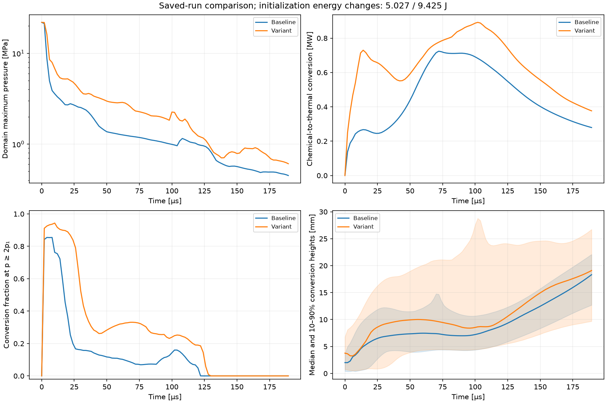
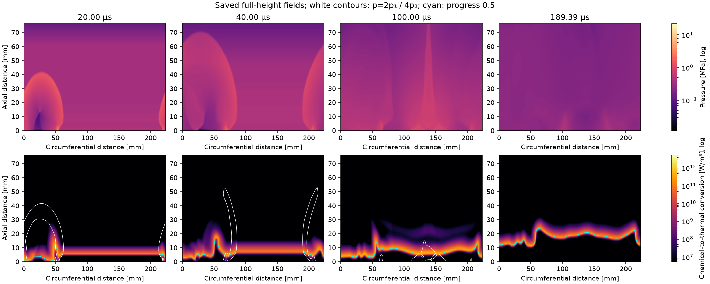
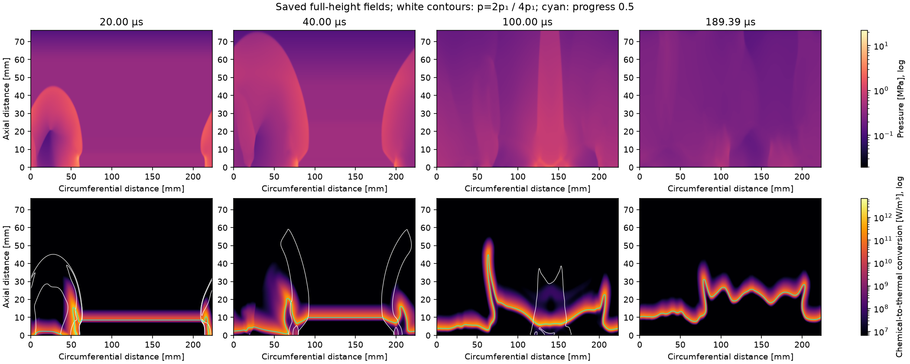
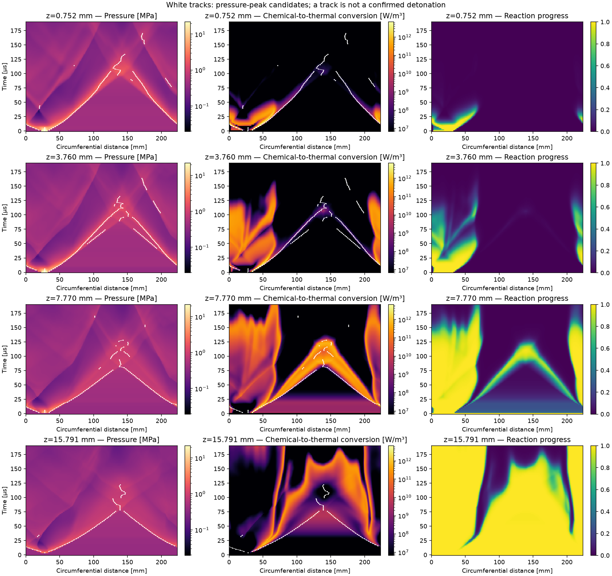

# D2 coupling diagnostics and controlled startup comparison

October 21, 2026. D2 adds reusable analysis of the saved D1 run and one bounded
startup experiment. The CFD solver, reaction source, calibration, inlet/outlet
closures and time integration remain byte-identical to D1.

**Result:** doubling the initial layer from 3.8 to 7.6 mm strengthens the early
transient, but does not demonstrate sustained rotating detonation by 189.394 µs.
Both runs remain numerically valid. Late reaction is concentrated near the
fresh/product interface rather than maintaining a persistent association with
the tracked pressure peaks. The root cause is still not isolated. See [RDE-001](run937_unresolved.md) for the
canonical open-case record, distinction between development and physics milestones,
parameter audit, candidate causes and criteria for a fix.

## Implementation

`coupling.py` reads a completed/checkpointed saved prefix through the existing
reader. It does not import or advance the solver. `plot.py --coupling` adds:

- Full-height pressure and chemical-to-thermal conversion panels, with pressure
  contours at 2p1/4p1 and the xi=0.5 contour for spatial context.
- Time–height maps of circumferential mean conversion and maximum pressure,
  plus conversion-weighted axial 10/50/90% quantiles.
- Periodic pressure-peak tracks on rings requested at 1, 4, 8 and 16 mm. Actual
  cell-center positions are 0.752, 3.760, 7.770 and 15.791 mm.
- Saved candidate positions, signed interval speeds, fitted segment speeds,
  nearby reaction rates, and distance to the nearest qualifying reaction peak.
- A two-case comparison that lists every changed config field, calibration and
  numerical-source equality, and both initialization energy changes.

The chemical conversion diagnostic is **rho*q*omega**, in W/m³. It describes
conversion of stored chemical energy to thermal energy; it is not a second
source added to the total-energy equation. Domain integration includes dx, dz
and the constant radial depth. Quantiles assume uniform conversion inside each
saved cell. Zero conversion gives null fractions/quantiles, not invented zeros.
Reaction-rate snapshots are required; missing fields are not treated as no reaction.
Zero and below-display-floor conversion are black in the logarithmic figures.

## What the tracks establish

Pressure candidates must exceed **2p1 = 755.834 kPa** and have prominence at least
**0.25p1 = 94.479 kPa**. Peak spacing is at least ceil(L_half/dx), two cells here,
enforced across the periodic seam as well as within the array. Plateaus have one
representative. Reaction-rate peaks use a threshold of 1000 /s and prominence
100 /s. Nearby rate is measured within 2L_half = 2 mm of a pressure candidate.

Adjacent-frame tracks use mutual nearest neighbors on the periodic ring, a
maximum candidate speed of 2D_CJ = 4942 m/s, and a two-cell ambiguity margin.
Missing detections, ambiguous associations and temporal spacing that permits a
half-circumference displacement break tracks. The algorithm does not bridge a
collision or infer identity across a dropout. Distances and speeds use the
reduced model's **mean circumference**, not Mundt's outer-radius speed convention.

These thresholds are explicit inspection choices, not calibrated physical
criteria. Pressure peaks are not automatically shocks. Track counts are not
wave counts; spatial overlap is not a detonation classifier. The nearest reaction
peak may belong to an unrelated feature, and its distance is not a ZND length.
Confirmed detonation passage count remains null. Data cadence is approximately
2 µs plus output events; the tracker does not imply native-step temporal resolution.

## Controlled experiment

The only changed case field is `initialization.fill_height_mm`, from **3.8 to
7.6 mm**, in `rde_sim_starter/cases/run937_fill_7p6mm.yaml`. The inherited
initializer also extends the ignition/product masks through that layer. Thus
the patch volume, initial fuel inventory and initialization energy change along
with fill height. This is a startup-configuration sensitivity, not an isolated
fill-height experiment at fixed igniter energy.

| Quantity | D1 baseline | D2 startup variant |
|---|---:|---:|
| Requested initial fill height | 3.8 mm | 7.6 mm |
| Axial cells initially below fill boundary | 8 | 15 |
| Signed initialization energy change | 5.0265 J | 9.4247 J |
| Grid | 447 × 152 | 447 × 152 |
| End time | 189.393939 µs | 189.393939 µs |
| Accepted steps | 13,165 | 13,165 |
| Invalid-state count | 0 | 0 |
| Largest recorded progress excursion | 6.66e-16 | 8.88e-16 |
| Maximum inventory/storage-scaled budget residual | 6.69e-14 | 3.02e-14 |
| Final maximum pressure | 0.450731 MPa | 0.607945 MPa |
| Final thermal conversion rate | 0.279444 MW | 0.376717 MW |
| Final median conversion height | 18.323 mm | 19.096 mm |

Chemistry, source CFL, flow CFL, grid, plenum, outlet, geometry, ignition pressure
and circumferential patch dimensions are unchanged. Numerical source fingerprints
match exactly between the cases. The baseline data were reused, not rerun.
No case was extended past the three-reference-interval cap.

The surrogate's computed shock-to-50/90/95/99% reaction distances are approximately
1.000/3.140/4.177/6.809 mm. These are distances along its 1D ZND solution, not an
axial fill-height requirement or physical detailed-chemistry validation. The early
movement of conversion away from the initial layer motivated this startup check;
no universal fill-height/reaction-length threshold is assumed.

## Observations

At 20 µs, 36.5% of baseline conversion occurs where pressure is at least 2p1;
the variant has 88.9%. At 40 µs those fractions are 14.2% and 28.3%. By 130 µs
both are negligible under that diagnostic, and at the final time both are zero
because even the domain maximum pressure is below 2p1. The threshold does not
measure causality; the full pressure/conversion/progress fields supply the context.

The larger start increases early pressure and chemical conversion. Later,
pressure peaks weaken while an extended reacting band follows the fresh/product
interface. The near-injector ring loses strong reaction even while pressure peaks
are still detected. Candidates persist longer in the variant (to approximately
170 µs at the lowest ring, versus 130 µs in the baseline), but their continuation
does not imply sustained detonation. The separate pressure and conversion fields
remain essential when interpreting those tracks.









Each field figure includes its own color scale. Use the common-unit comparison
panel for quantitative differences between cases. The tracked features are grid-
level pressure maxima, not resolved leading shocks or measured experimental modes.

Native RK-integrated chemical conversion is **87.267 J** for the baseline and
**122.408 J** for the variant. Trapezoidal integration of the saved snapshot
conversion gives 87.208 J and 122.306 J respectively (about 0.068% and 0.084%
lower). That discrepancy is snapshot quadrature/sampling error, not a native
conservation residual; use the native budget for conservation claims.

This single comparison shows that the tested larger startup does not resolve
the missing sustained state. It does not rule out other initialization effects,
prove numerical contact burning, or validate the one-step chemistry. Numerical
mixing at the interface, insufficient spatial resolution, chemistry and outlet
influence remain possible contributors. Reaction continuing at the interface
also means this is not total chemical extinction.

## Verification and reproduction

**51 tests passed, none skipped, in 56.944 s**, including the opt-in 1D reactive
baseline. See [the full log](d2_test_log.txt). The eight new tests cover periodic
seam/plateau detection, seam spacing, known signed speeds through wrapping,
ambiguous collisions, dropouts and cadence/speed gates, dimensional conversion
integrals and height quantiles, invalid data, exact changed-input reporting,
read-only plotting and missing-rate rejection. The import check includes the new
module. The test log contains Matplotlib pending-deprecation notices; no test
failed. The suite ran in staging using the existing repository environment.

From `rde_sim_starter`, using new output destinations:

```sh
RDE_RUN_REACTIVE_BASELINE=1 NUMBA_NUM_THREADS=2 ../.venv/bin/python -m unittest discover -s tests -v
../.venv/bin/python plot.py --coupling runs/d1_run937 --out runs/new_coupling
NUMBA_NUM_THREADS=2 ../.venv/bin/python run.py --case cases/run937_fill_7p6mm.yaml --out runs/new_startup
../.venv/bin/python plot.py --coupling runs/d1_run937 --compare-run runs/new_startup --out runs/new_comparison
```

`--heights-mm` selects other rings inside the domain. All output directories must
be new. Each comparison contains `baseline/` and `variant/` figures and full
`coupling.json` reports, plus `comparison.png` and `comparison.json`. No plotting
command advances CFD or modifies saved inputs. Source hashes identify the analysis
implementation separately from the frozen numerical implementation.

Bulk outputs are under `runs/d2_fill_7p6mm` and `runs/d2_coupling_comparison`
(Git-ignored). Selected figures and [compact metrics](d2_coupling_metrics.json)
are retained with this report. Absolute paths inside generated reports record
the locations used during analysis, including staging; the copied data are the
same bytes. D1 numerical checkpoints remain compatible because D2 changes only
analysis, rendering, tests and an additional case file. No dependency or compiler
installation was needed. D1 artifacts and the default configuration are preserved.

## Next focused work

Investigate whether numerical mixing at the hot-product/fresh-gas interface drives
premature reaction, using a small controlled contact problem with fixed chemistry
and a spatial refinement comparison. Use its outcome to choose a bounded 2D
refinement or a separately verified chemistry experiment. Do not infer a physical
flame speed from this diffused interface, retune chemistry to the mesh, or start a
parameter sweep to obtain a visually appealing rotating wave. D2 provides the
diagnostics for that investigation; it does not resolve engine-model validity.
