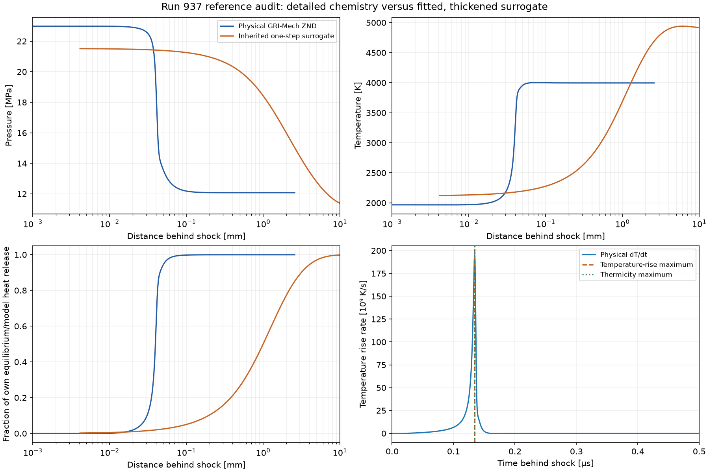
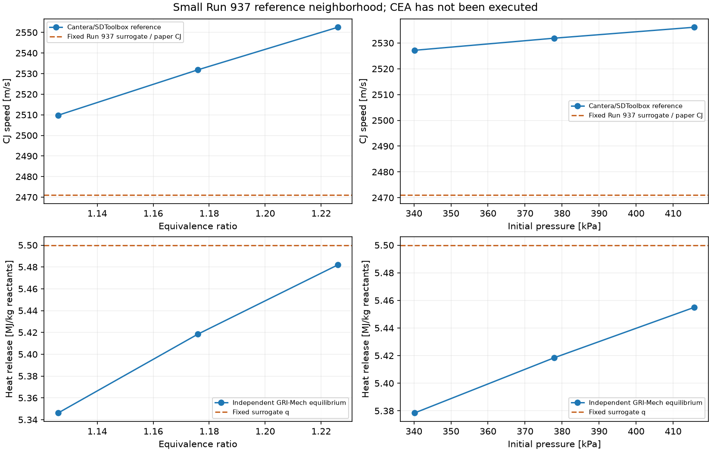
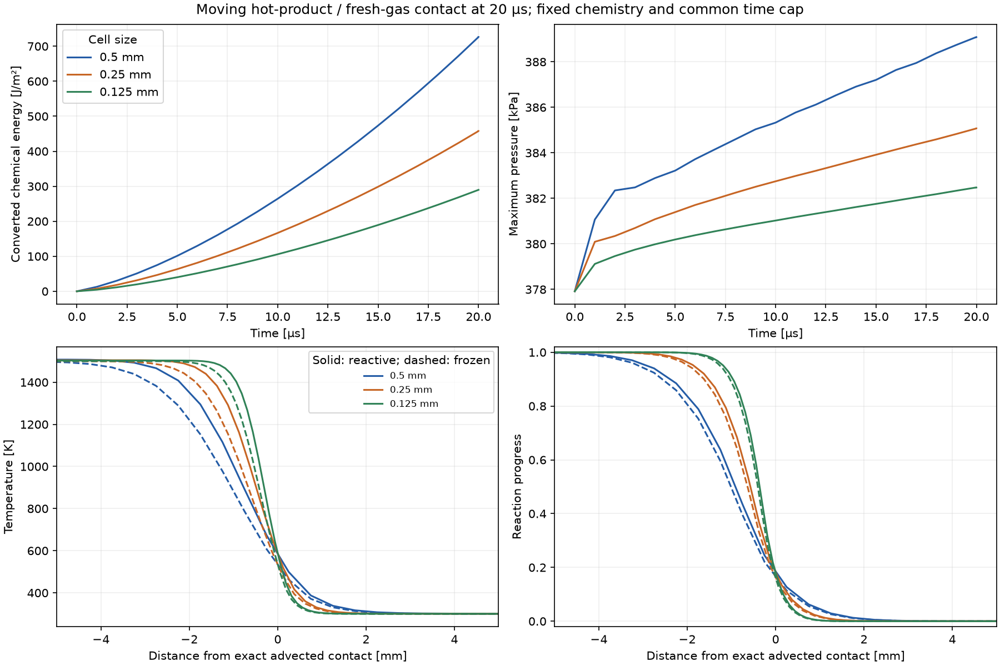
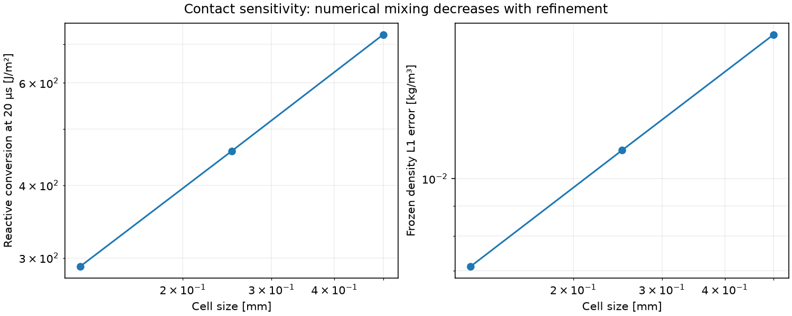
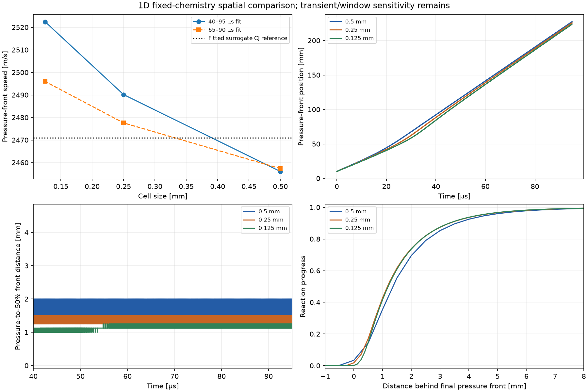

# D3: physical reference, contact reaction and spatial sensitivity

October 22, 2026. **RDE-001 remains OPEN.** This stage supplies evidence for the
next experiment; it does not establish sustained rotating detonation. The 2D
solver, baseline case, chemistry parameters, feed/outlet and 3.8 mm initial layer
are unchanged. No new 2D run was performed. D0–D3 are development increments;
broader Stage 1 assessment and Stage 3's sustained-wave criterion remain incomplete.

## Findings that affect the next decision

1. The pressure-balanced moving-contact problem produces heat through reaction
   in numerically mixed cells. Conversion falls substantially with refinement.
   This makes contact mixing a demonstrated numerical concern for this surrogate,
   but does not prove it causes the observed 2D wave decay.
2. The 1D wave propagates at every tested spacing. Its speed depends on both
   spacing and the chosen time window. The former single-grid match to fitted CJ
   speed was insufficient evidence of spatial convergence or a settled wave.
3. The independent physical reference has similar CJ speed and heat release,
   but different product thermodynamics and much shorter reaction structure.
   Artificial broadening is intentional in the inherited prototype; the new
   calculation quantifies its size, rather than establishing that broadening is safe.

**Subsequent planning update:** the [paper/model audit](mundt_model_audit.md)
now requires a controlled case specification before further studies. It identifies
hardware/model mismatches and quantifies grid-dependent startup charge/energy.
The recommendation below records the D3 decision and is on hold pending that
specification; the D3 results themselves are unchanged.

**Test proposed at completion of D3:** one requested 0.25 mm Run 937 baseline against the saved
0.5 mm case, with unchanged chemistry, initialization geometry and boundaries,
and the same three-reference-interval cap. Record actual initial inventory and
ignition energy on each grid. Compare fresh-gas replenishment and pressure/reaction
association as well as peak pressure and budgets. Do not change kinetics with the
mesh. A continuing failure then guides one specific boundary or surrogate-model
experiment. Two-step induction remains a candidate requiring separate verification.

## G0 physical-reference subset

Cantera 3.2.0, its `gri30.yaml` GRI-Mech 3.0 mechanism, and the vendored SDToolbox
Python source were used at CH4:O2 = 1.176:2, 300 K and 377916.972 Pa. Pressure
is the inherited Eq. 4.1 estimate, not a measured prescribed chamber pressure.
A five-point CJ/heat-release neighborhood varies phi by ±0.05 at fixed pressure
and pressure by ±10% at fixed phi. Detailed ZND is calculated only at nominal
conditions, including a stricter-tolerance repeat.

| Quantity | Physical reference | Inherited surrogate / paper target |
|---|---:|---:|
| CJ speed | 2531.861 m/s | 2471 m/s, fitted |
| CJ temperature | 3994.14 K | 4885.15 K |
| CJ pressure | 12.0194 MPa | 10.9515 MPa |
| Frozen post-shock temperature | 1968.00 K | 2116.25 K |
| Frozen post-shock pressure | 22.9843 MPa | 21.5251 MPa |
| Equilibrium/model heat release | 5.41847 MJ/kg | 5.5 MJ/kg |
| Shock-to-50% heat release | 0.03952 mm | 1.000 mm |
| Shock-to-90% heat release | 0.04533 mm | 3.140 mm |
| Shock-to-95% heat release | 0.05108 mm | 4.177 mm |

The new CJ speed is 2.46% above the paper target. That difference remains to be
reconciled with the paper's exact thermochemical inputs/version; neither the
paper value nor the production calibration is silently replaced. The half-heat
length is about 25 times shorter than the surrogate's, while the surrogate CJ
temperature is about 22% higher. The present 0.5 mm grid cannot directly resolve
the physical reaction zone. Substituting the physical length into this coarse
model would be an uncontrolled model change, not a demonstrated fix.

Heat release uses fresh minus CJ-equilibrium product mass fractions dotted with
species formation enthalpies per mass at 298.15 K. This follows the stated
product-state convention using GRI-Mech thermodynamic data. **NASA CEA was not
executed:** this is an independent equilibrium cross-check, not exact CEA replication.
Full Chapter 4 curves and the physical-reference registry are still follow-on work.

Mundt's induction marker is maximum dT/dt: 0.134400 µs here. The paper-style
length `u_VN * t_ind` is 0.03670 mm; integrated shock-relative travel to that peak
is 0.04064 mm. They are different definitions. The factor-29 proxy is **1.0644 mm**,
versus the inherited approximate 0.8 mm plot estimate. It is not an observed
cell width in the CFD calculation. The thermicity maximum is recorded separately.

### Reference checks and provenance

The driver minimizes unmodified upstream `CJ_calc` over density ratio [1.3, 2.5]
with a 60-evaluation limit. It checks jump residuals, elemental conservation and
equilibrium sonic speed. It uses checked SciPy BDF integration of unmodified
`ZNDSys`, retaining solver termination and raw species errors; the upstream
convenience driver does not expose all those checks. The driver locates maximum
dT/dt with dense output and stops before frozen Mach 0.995 if that event occurs.
Both nominal and strict integrations reached the requested 2 µs without that event.

CJ jump relative residuals are below 3e-10; CJ equilibrium Mach is 0.999990.
The nominal/strict relative changes are approximately 9.5e-12 for speed,
2.8e-8 for heat release and 1.0e-7 for induction time. The integrated ZND energy
residual is about 6.7e-5 in both runs; tighter integration does not eliminate that
residual. It remains below the documented 1e-3 acceptance bound. Raw species
negatives are of order 1e-11 and sum errors below 5e-13; no manual clipping is
applied. SciPy BDF emitted an overflow warning in Jacobian-step adaptation.
The warning is recorded in summary/log; successful termination, finite profiles,
invariant checks and the tolerance comparison support use at the reported accuracy.
These checks do not validate GRI-Mech kinetics against an experiment.

Upstream: [Caltech SDToolbox](https://shepherd.caltech.edu/EDL/PublicResources/sdt/),
[archive](https://shepherd.caltech.edu/EDL/PublicResources/sdt/SDToolbox.zip),
[license](https://shepherd.caltech.edu/EDL/PublicResources/sdt/LICENSE.txt), and
[Cantera thermodynamic API](https://www.cantera.org/stable/python/thermo.html).
The archive's Python headers say April 2026 although its website label is older.
Source and mechanism SHA256, package versions, algorithms, inputs and tolerances
are recorded in [metrics](d3_metrics.json) and the vendor provenance manifest.

## Moving contact: six bounded controls

A single contact starts at 80 mm in a 160 mm open tube. Hot, fully reacted gas
at 1500 K is left of fresh 300 K gas; both have 377916.972 Pa and velocity
300 m/s. Pressure-balanced conservative cell averages initialize the discontinuity.
The run lasts 20 µs; unit transverse area makes integrated conversion J/m².
Each grid has reactive and frozen controls. Only k=0 disables the frozen source;
all controls retain the same reactive-source time cap, 14.455 ns. Chemistry is
fixed across grids, and native source/flux accumulation supplies conservation checks.

| Cell size | Reactive conversion at 20 µs | Final maximum pressure | Frozen density L1 error |
|---|---:|---:|---:|
| 0.5 mm | 726.439 J/m² | 389.091 kPa | 0.017484 kg/m³ |
| 0.25 mm | 457.786 J/m² | 385.073 kPa | 0.011160 kg/m³ |
| 0.125 mm | 289.779 J/m² | 382.481 kPa | 0.007108 kg/m³ |

Frozen controls have zero conversion and uniform pressure to roundoff. Native
budget residuals stay around 1e-15. Boundary-state changes in reactive cases are
about 1.43e-6, consistent with the very small cold-gas source; there is no material
boundary contamination of this localized experiment. Cold-source background is
not mathematically zero and is not subtracted from the reported totals.

Refinement reduces numerical spreading and integrated reaction. This inviscid
model contains no molecular diffusion/heat conduction: the broadened interface
is not a resolved physical flame. These three grids do not establish an
asymptotic limit or the fraction of 2D decay attributable to interface burning.

## One-dimensional propagation: fixed chemistry, three grids

All runs use the original 250 mm tube, 10 mm hot ignition patch, twice-CJ initial
patch pressure, source fraction 0.05 and 95 µs duration. The front operator is
the last cell above twice initial pressure; reaction-front location uses xi=0.5.
Their grid-level positions are not subcell shock fits. Parameter hashes and
saved primitives/history accompany each run.

| Cell size | Speed, 40–95 µs fit | Speed, 65–90 µs fit | Final pressure-to-half-reaction distance |
|---|---:|---:|---:|
| 0.5 mm | 2456.055 m/s | 2457.327 m/s | 1.50 mm |
| 0.25 mm | 2490.157 m/s | 2477.590 m/s | 1.25 mm |
| 0.125 mm | 2522.453 m/s | 2495.972 m/s | 1.25 mm |

All three complete without invalid states. The final pressure fronts remain
inside the domain. Front trajectories retain initialization/transient effects;
window dependence is appreciable, especially on the finest mesh. No converged
speed or formal convergence order is claimed. The correct analytic comparison
for these runs remains the 2471 m/s surrogate CJ speed, because their chemistry
has not changed to the physical mechanism.

## Verification, artifacts and reproduction

The full 59-test suite includes the opt-in reactive baseline and eight new tests:
conservative moving-contact averages; frozen/reactive controls and budgets;
fixed-chemistry grid setup; analytic shock jump conservation; first crossing
without extrapolation; incompatible calibration rejection; failure evidence;
and physical-reference plotting without chemistry/CFD execution. Import coverage
also verifies the new modules do not load Cantera or render/solve on import.
See [test log](d3_tests.log) and [reference run log](d3_reference.log).

Local bulk artifacts: `rde_sim_starter/runs/d3_contact`, `d3_refinement`,
`d3_reference`. Selected figures and [complete compact metrics](d3_metrics.json)
are retained here. Plotting reads saved arrays, without advancing a solver or
altering source artifacts. The optional dependencies live in `.reference-deps`
and do not upgrade the pinned CFD environment. See [README commands](../../README.md#d3-investigation-and-graphs).
