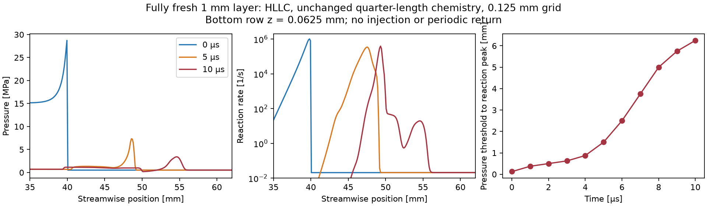

# Why the current 2D model loses its detonation wave

Final assessment at the **22:00 UTC deadline, October 22, 2026**. Branch
`2d-modelling-detwave-sustaining-fix`; original checkout preserved. Detailed
measurements, hypotheses and provenance are in
[the investigation log](detwave_sustaining_investigation.md).

## Main finding

**The model was checked against its initial fresh layer, but not the much thinner
layer it actually replenishes.** The tested thickened-chemistry/grid combination
loses coupling under expansion at that thinner layer; kinetics and spatial error
have not been uniquely separated. Numerical contact mixing also
burns fresh material prematurely. Fixing that mixing improves refill but does
not, by itself, sustain detonation.

This is a supported diagnosis of the tested reduced model. It is not evidence
that the experimental engines should fail or that a 2D workflow cannot work.
**No sustained periodic engine solution has been demonstrated in this investigation.**

| Discriminating evidence | What it establishes |
|---|---|
| Original Run 937 chemistry loses reaction/pressure coupling despite a formed start; shortened chemistry remains coupled through the final 80 us sample in the larger engine | Startup energy alone is insufficient; reaction timescale matters |
| Smaller 25-FI-5 controls also fail; changing charge fraction improves the first transit but not sustained return | The problem is not confined to one Run 937 input, and the original fixed-length charge biased the smaller-engine comparison |
| HLLC reduces stationary-contact artificial conversion by about 100,000×; actual engine cold refill at 30 us grows from 0.65 to 1.14 mm at nearly identical delivered mass | Numerical mixing is a demonstrated source of premature burning |
| HLLC engine still loses strong coupling after return; at 50 us only 3.23% of heat is above twice initial pressure | Contact restoration is a useful numerical correction, not a complete sustaining fix |
| Fully fresh 1 mm layer, HLLC, same chemistry/grid, no injection or periodic return: pressure threshold/reaction peak separate by 6.25 mm in 10 us; local front rate falls to 19/s | The tested model cannot retain coupling in a layer comparable to its actual refill, even without the engine's return/injector complications |

The last test finished normally with no invalid states and conservation residual
around 1.6e-15. Measured signal speeds stayed within the declared bounds and
remote-boundary causal margins remained positive. Conservation and timestep
checks therefore do not resolve the governing model-scale problem.

## Critical assumptions to correct

1. **Mundt's inferred fill height is not a CFD injection prescription.** It uses
   measured wave frequency. A simulation selecting a different wave count/speed
   does not automatically replenish the same layer before return. The small
   engine returns in roughly 28–30 us while the replenished layer is around 1 mm.
2. **Matching CJ speed does not validate chemical timing.** The original surrogate
   has half/95%-reaction lengths 1.000/4.177 mm. The shortened surrogate still has
   0.250/1.044 mm. The independently computed detailed-chemistry reference at the
   original Run 937 state gives 0.0395/0.0511 mm. That reference is not an exact
   calculation for every secondary operating point. The one-step law also lacks
   an induction stage and explicit pressure dependence; multiplying its rate
   accelerates unwanted mixed-gas burning as well as shock reaction.
3. **A formed wave surviving the initial charge is not sustained operation.**
   Pressure/reaction coupling must survive return into newly injected material.
   Global pressure maxima and total fresh mass cannot establish that.
4. **The secondary cases are declared surrogates, not exact experimental reruns.**
   Equivalent premixed supply, frozen mixture/EOS/rates, unresolved injector
   mixing, and omitted radial dynamics remain approximations. The real paper
   describes separate feeds and a physical predetonator, not our uniform hot
   product layer and formed-charge prescription.

## Changes actually supported and delivered

- Optional HLLC flux with conservative chemical-energy/progress transport;
  HLL remains the default. Exact flux/contact, shock, planar reaction and
  conservation checks passed. HLLC's broader shock stability and grid convergence
  are not claimed from these bounded tests.
- Conservative formed-start and case-definition checks; secondary-engine
  geometry, supply, diagnostic stations and metadata are explicit.
- Reproducible bounded runs, checkpoint/source provenance, coupling and refill
  diagnostics. Latest reviewed main `f12cca1` was merged into this branch at the
  requested checkpoint; it added optional wall/radial models but no sustaining fix.

## What to do next, without a six-engine tuning exercise

Use the **actual replenished-layer thickness** as the next acceptance gate for
chemistry and spatial resolution. Validate shock induction/energy-release timing
and unshocked mixed-gas ignition against a physical reference, then demonstrate
coupled propagation in that layer with a resolved reaction zone before repeating
the periodic engine. Carry the same accepted closure into the six configurations;
do not fit each engine until it sustains. A faster one-step rate on the existing
grid alone would not establish physical accuracy.

For a demonstration today, the verified result is **bounded coupled propagation**
in the larger engine and a reproduced mechanism of failure on return in the
smaller engine. It must not be labeled a validated steady RDE. More ignition,
repeated reseeding or artificially maintaining a fresh layer would hide the test.
The larger-engine run was intentionally stopped at the deadline after 80.138 us
(10,357 steps; 2 h 47 min wall time), short of its 189.394 us target. Its complete
80 us field still has a coupled forward front at x=186.36 mm: pressure 18.43 MPa,
nearby reaction rate 8.50e5/s, and 0.125 mm absolute peak separation at z=1.062 mm.
It has not crossed the 223.681 mm periodic seam or completed a circuit from its
initial position. This is an unfinished sustaining test, not evidence of extinction
in the larger engine. Zero invalid states were recorded. The 80 us checkpoint and
all source provenance are preserved; all investigation jobs are stopped and the
follow-up automation has been removed.

| Run | Last complete saved interval | Outcome |
|---|---:|---|
| Run 937, original chemistry | 40 us | Completed; lost coupling |
| Run 937, shortened chemistry | 80 us | Deadline stop; coupled first transit, no return |
| 25-FI-5 geometry control | 52 us | Intentionally stopped after wave loss |
| 25-FI-5 high flux, large charge | 43 us | Intentionally stopped after wave loss |
| 25-FI-5 high flux, compact charge, HLL | 50 us | Lost coupling around first return |
| Same compact case, HLLC | 51 us checkpoint / 50 us full field | Better refill, still lost coupling |
| Fully fresh 1 mm layer, HLLC | 10 us | Completed; pressure/reaction separation |

[Final large-engine metrics](detwave_short_final_metrics.json) and
[space-time plot](detwave_short_final/space_time.png) preserve the final evidence.
Raw `KeyboardInterrupt` statuses on intentionally stopped jobs describe manual
termination, not a solver failure.

## Relation to the literature

- Mundt (local thesis), Tables 2-1, 3-2, 3-3 and printed pp.26, 74–78: geometry,
  measured operating points, physical ignition and inferred fill height. Its
  experimental averaging interval is much longer than our bounded CFD windows.
- [Strakey & Ferguson, AIAA 2022-1113](https://netl.doe.gov/projects/files/ValidationofaComputationalFluidDynamicsModelofaMethaneOxygenRotatingDetonationEngine_010522.pdf):
  methane/oxygen CFD uses multistep chemistry and a finite ignition kernel, with
  injector/manifold/exhaust modeling and millisecond development. It supports
  simplified initialization, not validation of this one-step timing or inlet.
- [Hishida et al.](https://link.springer.com/article/10.1007/s00193-008-0178-2):
  published 2D simplified-chemistry rotating-detonation results support feasibility.
  Only the accessible abstract was used; exact model coefficients were not checked.
- [Toro, Spruce & Speares](https://doi.org/10.1007/BF01414629): contact restoration
  motivates the tested HLLC correction. It does not supply missing chemical or
  turbulent-mixing physics.

No 3D run, Modal pricing analysis, or six-engine calibrated production result is
claimed. The remaining uncertainty is substantive: these tests identify model
incompatibilities, but have not produced a validated sustaining closure.

## Subsequent main refresh and clarification

Main through `050995e` was reviewed and integrated after the deadline at the user's
request. It adds completed radial-control evidence and GIF/reporting functionality,
with no new evolution-code change relative to our already merged physics. Existing
results and source snapshots remain intact; no engine tests were repeated.
[Refresh review](detwave_main_refresh.md) explains the decision and clarifies that
Mundt's injector geometry is physically important but unresolved by our inlet.
The 1 mm control is evidence of a model limitation, not unique proof of the cause
of the experimental-replication discrepancy.
