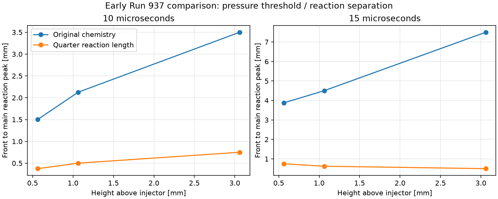
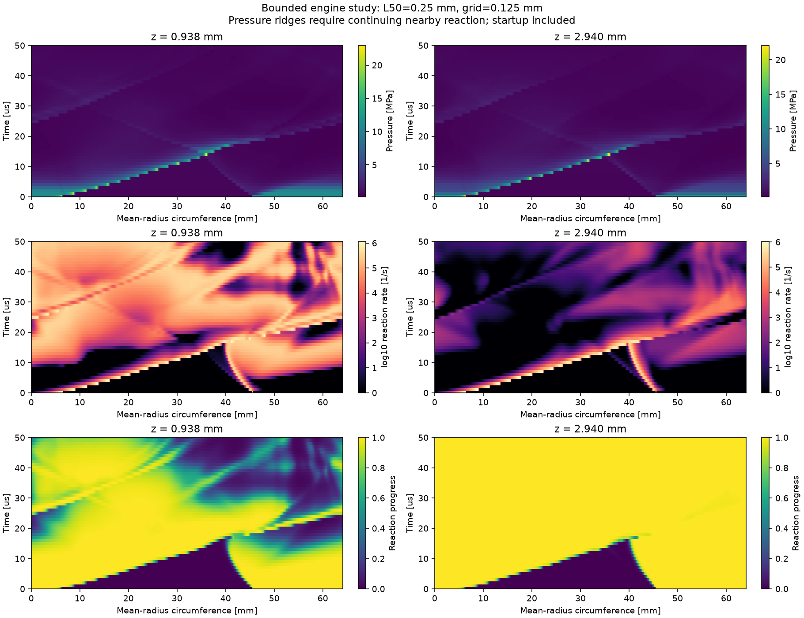

# Detonation sustaining investigation — October 22, 2026

Branch: `2d-modelling-detwave-sustaining-fix`, created from GitHub main
`9695ae57b718bbc21394956c6fb7c961ebf8af88`. Worktree:
`/private/tmp/prox-rde-detwave-fix`. Original dirty main checkout is preserved.
The user's branch instruction supersedes historical documents saying main only.

## Initial assessment and hypotheses (before new runs)

Reviewed README, HANDOFF, revision 10, the C1–C6 plan, paper/model audit,
RDE-001, C5 results and the local independent investigation. Historical plans
are context, not fresh evidence. Mundt printed pp. 9, 11–12, 52, 74–78 and 90
were checked directly in the supplied PDF.

**Critical assumption:** experimentally sustained Run 937 does not imply this
particular reduced model must sustain. The 1 mm half-reaction distance is our
numerical model choice; Mundt does not prescribe it. Its 4.177 mm 95%-reaction
tail is comparable to a nominal 3.8 mm fresh layer. The physical reference has
0.03952/0.05108 mm half/95% distances. Similar CJ speed does not validate timing.

| Hypothesis | Existing evidence | Discriminating next evidence |
|---|---|---|
| H1: slow thickened chemistry loses coupling under transverse expansion | C3 thin formed layer fails; thick layer survives its bounded window; C5 shorter chemistry remains coupled for 10 us | Same-mesh engine comparison with fixed formed startup and original/quarter-length chemistry |
| H2: blast startup never establishes a viable wave | Original zero-velocity burned patch is not a traveling detonation; C4 blast is weaker | Original chemistry with formed startup tests whether startup alone suffices |
| H3: contact diffusion consumes/heats fresh gas and alters coupling | Contact burning is mesh dependent; initial aligned thin layer still fails | Inspect full fields, fresh inventory, ring heat release; conditional mesh check, not blanket dismissal |
| H4: replenishment/outlet assumptions prevent periodic survival | Layer controls omit both; existing inlet is idealized and annulus exit omits expansion | Periodic engine through 189.394 us, with native budgets and inlet/outlet diagnostics |
| H5: timestep or coordinate defect | C1 direction/row and C2 source checks argue against tested defects | Independent reactors and planar timestep controls for the selected execution settings |

Do not call H1 uniquely confirmed, impose a universal h/L50 threshold, infer
detonation from pressure alone, or use larger ignition energy as an automatic fix.
The inferred 3.8 mm refill height uses *measured* two-wave frequency; it is not a
fixed operating layer for a simulation that may select one wave.

## Added user-requested case check: 25-FI-5

The user requested another engine configuration to check whether the chosen
test itself contains a silent problem. Selected **25-FI-5**, whose high-flux
Table 3-3 row has one wave at all three back pressures. Checked the original
table text and rendered page 69, plus Tables 2-1/4-1 and pp.56–57,72–73.
Geometry: outer/inner radius 12.7/7.7 mm, length 25.4 mm, nominal injector area
ratio .110, 48 pairs. The table reports 319.20 kg/s/m2, 102.29 g/s, phi=1.19,
and one wave at 3.5/52/97 kPa. These are three-run averages, not one named run.

H6: case-specific geometry, operating point, or silently retained metadata
causes the observed failure. Two bounded secondary controls distinguish these:

1. `cases/detwave_25fi5_geometry.yaml`: only geometry, geometry-scaled total
   reference mass flow and diagnostic stations change from the short-chemistry
   Run 937 control. Same EOS, kinetics, initial pressure, plenum/back pressure,
   initial layer and finite charge. This is **not** an experimental 25-FI-5 run.
2. `cases/detwave_25fi5_high_flux.yaml`: same small geometry and frozen gas/rate
   constants, but mass-flux reference 319.20 and back pressure 97 kPa. The
   equivalent reservoir pressure is derived as 1799.936 kPa to give a choked
   capacity of 319.20 kg/s/m2 with unchanged Cd=.76; it is not a measured feed
   pressure. Transient flow is still predicted, not imposed alongside pressure.
   Initial pressure follows the existing Eq.4.1 fit. Active phi remains 1.176
   to keep **exactly** the original gas/kinetics; Table 3-3's 1.19 is recorded
   separately (1.18% difference). Thus this is a near-condition surrogate
   cross-check, not a precise replication. No chemistry is retuned for success.

Both use 0.125 mm cells, source fraction .20, 3.8 mm initial layer and the same
25 mm finite charge. The charge occupies 39% of this circumference, versus 11%
in Run 937; periodic startup interaction changes. The inferred layer height is
not silently recomputed using an assumed simulated wave count. Durations are
189.394 us for the geometry control and 142.857 us for high flux (three intervals
using an approximate 21 kHz plot reading solely as a budget, not this row's
measured frequency). Both are shorter, cheaper domains; no extra mesh sweep.

**Limit:** gap/mean radius is .4902 versus .1404 in the original engine. The
unrolled model omits the stronger radial curvature and injector structure.
Agreement/disagreement can diagnose case sensitivity but cannot validate those
omitted effects. A shorter chamber also brings outlet influence earlier.

Input audit fixes prevent silent carry-over: secondary cases replace Run 937
experimental pressure arrays, restrict pressure stations to the actual chamber,
recompute annulus area/total reference flow, label estimated frequency and
derived plenum, and assert that every gas/kinetic constant stays identical.

Seven focused tests passed (12.624 s): geometry/area/constant preservation,
analytical choked capacity, actual saved-case execution with budgets, and the
four independent initializer checks. The secondary cases run sequentially with
one Numba thread to limit contention; execution log is `detwave_secondary.log`.
Output directories are `runs/detwave_25fi5_geometry` and
`runs/detwave_25fi5_high_flux`. No physics result from them is claimed yet.

The two active original runs keep their already-loaded numerical code. Before
adding generic `--case` support, exact copies of all fingerprinted source files
were preserved and hash-checked in `rde_sim_starter/runs/source_snapshot_v1`.
If one of those original processes is interrupted, resume with that archived
`detwave_study.py` and an **absolute** run directory. The current driver handles
the new cases; do not attempt an old checkpoint with its changed fingerprint.

## Predeclared test list and stop rules

1. Fast existing regression plus independent initialization/seam/inventory checks.
2. Evaluate existing supported source fractions 0.20 versus 0.10/0.05 in cold,
   warm and shock-heated reactors and formed planar waves. Accept <=2e-4 absolute
   progress error, decreasing on halving; planar speed change <1%, valid states,
   budget residual <1e-10. This changes accuracy settings, not chemistry or the
   integrator. If it fails, retain 0.05 rather than replace the integrator.
3. A 2 us engine benchmark at 0.125 mm; compare source fractions over an early
   common window before adopting the faster setting. Require <1% total heat
   difference and <=one-cell front displacement, valid states and budgets.
4. Periodic Run 937 geometry, formed finite 25 mm charge, 3.8 mm initial layer,
   1500 K products, original inlet/outlet; 0.125 mm mesh. Original and preselected
   L50=0.25 mm chemistry, no rate search. Cap each at three reference passage
   intervals (189.394 us). Stop on invalid state; preserve failed evidence.
   Check runtime after benchmark; stay within a few hours rather than launching
   a broad sweep. Chemistry-dependent ZND profiles change initial inventories;
   record that confound rather than calling this a pure identical-state A/B.
5. Assess late shock-associated reaction, travel beyond initial charge, periodic
   return into replenished gas, fresh inventory, boundary/source budgets, and
   pressure–reaction space-time plots. Conditional refinement only for a
   specific uncertainty. A short success is not validated steady Run 937.

## Literature implications

Mundt Table 3-2 (p.52) reports two waves and means over the final 100 ms of a
0.696 s burn. Equations 4.3–4.5 use measured frequency to infer refill height.
The h/cell-size >=4.5 discussion (p.90) is a thrust guideline, explicitly not a
rule; it is not a survival threshold for our artificial Arrhenius model.

[Strakey & Ferguson, AIAA 2022-1113](https://netl.doe.gov/projects/files/ValidationofaComputationalFluidDynamicsModelofaMethaneOxygenRotatingDetonationEngine_010522.pdf)
use a 12-species, 38-step mechanism with stiff split chemistry, include an exhaust
plenum, check numerical wave-speed sensitivity, and typically reach limit-cycle
operation after 3–5 ms. This supports checking chemistry/numerics and downstream
closure, not asserting that 189 us validates experimental means.

[Li, Mi & Higgins, geometric scaling](https://arxiv.org/abs/1405.7753)
study finite reactive layers with yielding confinement and critical dimensions.
Their pressure-dependent kinetics support the mechanism analogy, not a numerical
threshold transferable to methane/oxygen or this one-step surrogate.

[Wahba et al., 2026 preprint](https://arxiv.org/html/2603.24702v1), section 7.3,
explicitly distinguishes a wall-confined inert layer from an RDE exhaust: its
precursor-driven overdrive relies on upper-wall choking. Thus apparent survival
or high pressure in a confined control cannot automatically transfer to an open
engine. Their non-Arrhenius stable-front model is another mechanism analogy,
not a methane chemistry validation or evidence for changing our outlet to a wall.

## Execution/provenance log

- Initial literature/plan assessment complete. No new propagation result yet.
- Preflight correction, before engine runs: original chemistry's tabulated
  99.9999% tail is 23.768 mm, so a 20 mm charge cannot contain it. Use the same
  25 mm finite charge in both engine cases. The initializer correctly rejected
  the incompatible original-chemistry construction; no flow ran in that attempt.
- Four initializer checks passed: independent normal-shock identities,
  piecewise quadrature through the periodic seam, all five inventories across
  meshes/phases, and translation invariance through actual flow steps.
- Timestep prerequisite passed: nine independent reactor comparisons (300 K,
  900 K/20% reacted, 2116 K; source fractions .20/.10/.05) give maximum errors
  1.39148e-4 / 3.50421e-5 / 8.79328e-6 in the hot case, zero conserved-energy
  error and zero invalid states. The three formed planar runs have identical
  saved pressure-front speed fits (5–10 us: 2478.153 m/s), valid states and
  budgets. See `detwave_temporal.json`. Threshold quantization limits this speed
  comparison; the engine field/heat comparison remains required.
- Baseline regression: 78 discovered, 77 passed and one opt-in long propagation
  test skipped (294.6 s, concurrent work on host). Four new initializer tests
  passed separately. Logs are retained.
- Source-fraction .20 engine benchmark: 2 us, 240 accepted steps, no invalid
  states, about 170 s under concurrent host load. Flow CFL limits many steps,
  so increasing source fraction does not yield a fourfold engine acceleration.
- Engine timestep comparison passed at 2 us: .20/.10 converted heat is
  2.1393538/2.1396073 J (0.01185% difference), the forward pressure front at the
  1 mm ring is in the identical cell (27.4444 mm), and maximum budget residual
  is 6.22e-16. Conserved-state relative L1 difference is 1.18e-5 (energy-weighted;
  not a componentwise field bound). Zero invalid states. See
  `detwave_engine_temporal.json`. Both longer cases now use .20, unchanged
  flow CFL .4, flux, EOS and integrator. This short check is not proof of
  identical late nonlinear structures.
- Initial charge accounting: original/shortened cases have 19.2481/14.3321 J
  excess energy, 84.6617/82.7206 J unspent chemical energy, and
  0.0050751/0.0039816 kg m/s azimuthal momentum. Both use identical 25 mm
  geometric charge and 3.8 mm conservative layer height on 1789 x 610 cells.
  The original case is *more* strongly energized, not less. Different ZND
  profiles remain a confound; success of the short case cannot establish a
  universal chemistry-only threshold from this engine pair alone.
- Benchmark fields inspected: forward shock-associated reaction and a separate
  rear-startup disturbance are present. Numerical interface burning occurs along
  the initially fresh/product boundary. Native exit mass flux is nonzero by
  2 us; outflow cannot be dismissed on a claim that it begins at 43 us.

## Interim matched engine result: 10–15 us (19:43 UTC)

The original chemistry develops a growing separation between the forward
pressure front and the main reaction peak, even with a formed start. The
quarter-length chemistry remains much more closely coupled over this interval.
At the actual 1.062 mm ring, the separation grows from 2.126 to 4.501 mm for
original chemistry; the shortened case changes from 0.500 to 0.625 mm. At the
3.060 mm ring the 15 us separations are 7.502 and 0.500 mm respectively.
Within 2 mm of the forward front at 1.062 mm height, the original case's maximum
reaction rate falls from 133,154/s at 10 us to 4,468/s at 15 us; the short case
retains 668,669/s at 15 us. The rate ratio alone is not the test, since the
pre-exponential factor differs fourfold; the growing spatial separation and
original case's own rate collapse are the relevant evidence.



Definitions and exact values are in `detwave_early_engine_metrics.json`,
reproducible with `detwave_early_compare.py`. The front is the rightmost cell
above twice initial pressure in the forward x=22–100 mm sector, not a verified
shock label. The peak search is behind it in that same sector. These definitions
are limited to the 10/15 us pre-return frames and must not be used unchanged for
periodic tracking. Full 10 us fields were visually checked: the shortened case
has a compact forward reaction feature, whereas the original has a broader,
lagging feature. Both also contain interface burning and rear-startup waves.

**Interpretation:** this strengthens H1 and weakens the claim that changing
startup alone is sufficient for original chemistry. The original charge had
more initial excess energy, so this contrast cannot be attributed simply to a
weaker original ignition. The evidence agrees qualitatively with the finite
layer/expansion mechanism discussed above; it does not identify a universal
critical reaction length or prove that shortened chemistry sustains on refill.
Do not change production chemistry defaults on this early result alone.

The 25-FI-5 geometry-only 20 us field already has a much thinner fresh region
and substantial reaction away from the forward pressure feature. Its shorter
circumference introduces startup/return interactions sooner. This is a reason
to retain the separate high-flux case and inspect replenishment, not to label
all remaining pressure structures detonations. No secondary survival verdict
is available yet.

At this check, original/short/geometry runs reached 19/16/32 us, with no invalid
states and maximum scaled budget residual below 1.2e-15. High flux is queued
behind geometry. The current short-run extrapolation exceeds the wall-clock
budget; completing 189 us is not promised. Continue existing jobs without
duplication, reassess after the original 40 us job frees resources, and report
the actual attained interval at the 22:00 UTC deadline.

## Replenishment check and secondary stop decision (19:52 UTC)

Global fresh-species accounting distinguishes the two early failure contexts.
Original Run 937 has **more** unreacted mass at 20 us (18.295 mg) than initially
(15.393 mg), having injected 4.855 mg and reacted 1.952 mg. Its early loss of
coupling is therefore not explained by depletion of the engine's total fresh
inventory. This does not exclude local starvation or interface diffusion.
The short-chemistry Run 937 has 15.284 mg remaining at 20 us, versus 15.040 mg
initially; its compact forward feature persists in the inspected 20 us field.

The geometry-only small engine instead drops from 3.053 mg initially to
0.307 mg at 20 us (about 10% remaining), then recovers to 0.736 mg by 40 us.
At 20 us it has injected 0.927 mg but reacted 3.674 mg. Fresh mixture exiting
is negligible; the unreacted-mass identity closes to less than 3e-20 kg in
these snapshots. See `detwave_interim_fresh_inventory.json`. The initial
charge occupies much more of this annulus and its rear disturbance meets
the forward wave early. Thus this geometry-only transfer changes the startup
interaction and refill demand even while preserving the nominal initial layer.

The 0–50 us space-time plot shows the strong forward pressure/reaction feature
fading around 15–20 us, followed by weak travelling pressure structures.
At 50 us, full fields show broad low pressures and predominantly layer-interface
reaction; no compact, strong forward coupled front survives in that field.
This is failure to preserve the seeded wave, not proof that all later ignition
is impossible. It is also **not** a failure of an exact experimental 25-FI-5
operating point: this control deliberately retains Run 937 supply conditions.



To avoid spending the budget on a lost seeded wave, stopped the geometry-only
job after its complete 52 us sample and advanced the predeclared high-flux case.
The process caught the interrupt at 52.935 us and records `failed` with
`KeyboardInterrupt`, not a numerical invalid-state failure (count remains zero).
Do not use that incomplete interval as a new sampled result. The complete
checkpoint was copied to `checkpoint_before_manual_stop.npz` and the decision
is recorded in `manual_stop.json`. The 189.394 us target was **not completed**.
The sequential wrapper exited before launching high flux; high flux was then
started once with the unchanged current driver and one Numba thread. Its log
is `docs/verification/detwave_high_flux.log`, separate from the stopped wrapper's
`detwave_secondary.log`. No high-flux propagation result is available yet.

This strengthens the need to separate H1 (reaction/expansion coupling) from H4
and H6 (refill and case definition). Faster chemistry's early Run 937 improvement
cannot by itself guarantee periodic survival in another geometry.

## Big-picture reassessment requested by user

**Continue the bounded 2D investigation; do not conclude 3D is required.**
The numerical prerequisites are complete. They established trustworthy execution
of the selected surrogate, not suitability of its chemistry. The present engine
comparisons directly test wave support and refill, rather than launching more
generic numerical sweeps. The expensive Run 937 grid contains about 1.09 million
cells and requires thousands of small explicit steps even for tens of us;
wall-clock slowness is not itself evidence that the physics is impossible.

### What the source actually did

Rechecked Mundt printed pp.26,37,74,77–78 directly. This is an experimental
engine scaling study with thermochemical post-processing, not a demonstrated
unsteady CFD implementation of our one-step model. Separate methane and oxygen
feeds mix in the engine. A spark-ignited external pre-detonator supplies ignition;
its port is at 73 mm in the 76 mm engine and 22.4 mm in the 25 mm engines.
Premixing in §4.1.2 applies to the Cantera/SDToolbox reference calculation. The
fill height in Eq.4.5 is inferred using measured wave passage frequency; the
paper does not numerically inject or continually reset a prescribed 3.8 mm layer.
Our initial layer, uniform premixed face injection, hot upper products, equivalent
plenum and thickened one-step kinetics are additional modeling choices.

The directly inspected numerical setup in
[Strakey & Ferguson](https://netl.doe.gov/projects/files/ValidationofaComputationalFluidDynamicsModelofaMethaneOxygenRotatingDetonationEngine_010522.pdf)
uses a 5 mm initial fresh region with air above, an axial pressure taper, and a
2-degree hot kernel at 4 MPa/3000 K. It also resolves injectors/manifolds and uses
12-species chemistry. Thus detailed pre-detonator modeling is not a prerequisite
in that successful CFD study, but its simple ignition cannot be transplanted
while claiming the remaining closures match ours. Our formed-start control
already bypasses failure to establish an initial detonation; adding ignition
energy does not resolve its observed later decoupling.

[Hishida, Fujiwara & Wolanski (2009)](https://link.springer.com/article/10.1007/s00193-008-0178-2)
explicitly report sustained near-CJ rotation with a two-dimensional simple
chemistry model. Only the publisher abstract was accessible, so it establishes
feasibility, not a verified set of transferable methane-oxygen coefficients.
[Koch & Kutz (2020)](https://arxiv.org/abs/2007.14776) likewise demonstrate the
importance of the relative injection, mixing, combustion and exhaust timescales
in a reduced model. Neither validates our artificially chosen 1 mm reaction length.

### Deadline-focused decision and fallback

1. Finish the original 40 us control and prioritize periodic behavior in the
   existing shortened-chemistry and small high-flux runs. No additional six-case
   expensive sweep until one setup demonstrates repeat propagation into refill.
2. If faster chemistry propagates through fresh initial charge but fails on
   return, examine the local fresh-layer state and inlet recovery at the return,
   including startup counter-waves. That discriminates refill/startup from
   the earlier chemistry/expansion failure; do not simply shorten chemistry again.
3. A minimal supported prototype may retain inviscid 2D flow, premixed gas,
   conservative formed ignition and one common reduced-chemistry calibration
   procedure. It must predict refill rather than reset fuel or apply continuing
   ignition. Any changed initial layer or pressure profile is a labeled startup
   sensitivity, not a paper-prescribed condition or steady-survival guarantee.
4. For all six geometries, audit dimensions/areas and operating points using the
   same rules. **The current unrolled model has no direct radial-confinement or
   gap-dependent wall-loss closure.** Gap scales integral quantities and affects
   mean-radius circumference; it is not a resolved radial coordinate. Consequently
   a working wave alone cannot validate the experimental gap-width ranking.
5. If the autonomous reacting model cannot show periodic survival by the deadline,
   deliver its actual attained interval and diagnosed limitations. A separate
   reduced-order/shock-fitted performance demonstrator is a possible fallback:
   [Fievisohn (2016)](https://drum.lib.umd.edu/items/159d8be8-c108-4b3c-9a41-ea6287e7dad8)
   provides a literature precedent using CJ/shock-expansion theory and method of
   characteristics. Such a model conditions on a detonation solution and cannot
   count as a prediction that the wave sustains. It has not been implemented here.

No evidence currently establishes impossibility of 2D modeling. The strongest
supported criticism is of the selected reaction/refill scales and their presumed
equivalence to the experiment. No Modal resource or pricing investigation is
included, following the user's explicit withdrawal of that request.

## Higher-flow comparison and targeted startup control (20:14 UTC)

The high-flux small engine shows almost the same strong-front loss near
15–20 us as the geometry-only small engine. Its 30 us field contains a weak
travelling pressure structure with most reaction along the thin layer interface.
Higher absolute pressure alone is not evidence of better survival. The original
40 us and short Run 937 jobs remain active; no completed-period claim is made.

**Critical limitation of the high-flux control:** it froze the kinetic constants
deliberately, and `reaction_rate = k(1-progress) exp(-Ea/(R T))` has no direct
pressure dependence. With fixed gas properties and heat release, increasing
initial pressure scales density and shock pressure but leaves the tabulated
ZND lengths unchanged: L50=0.250 mm, L95=1.044 mm, full table tail=5.942 mm in
both small cases. It therefore does not reproduce the pressure-dependent
chemical length changes in Mundt's Cantera calculations. The nominal fill
velocity `mass_flux/rho_initial` is actually 60.77 m/s at low flow and 58.50 m/s
at high flow, because the fitted fresh density also increases. Raising mass
flux was not an isolated increase in refill speed. Keep this a boundary/operating
condition control, not a validation of methane kinetics across pressures.

The space-time histories also identify a test-construction issue: the same
25 mm formed charge takes 39.0% of the small circumference, leaving much less
unburned arc before its trailing disturbance meets the forward wave. This
differs substantially from the 11.2% charge fraction in Run 937. A single
targeted startup control is therefore added, **without another chemistry change**:

- `cases/detwave_25fi5_high_flux_compact_seed.yaml` preserves every active
  high-flux input except charge length, set to 7.162921 mm by preserving the
  original engine's charge/circumference ratio. This still contains the complete
  5.942 mm tabulated ZND tail. It is a smaller, lower-energy start, not a stronger
  ignition patch or a forced wave.
- Preflight checks input equality apart from charge/provenance, profile jump
  identities and conservative inventories. Save those in
  `detwave_compact_seed_preflight.json` before propagation.
- Run only after the present high-flux control is stopped following its field
  assessment, with cap 80 us and the same one-thread execution. Look for the
  time/location of counter-wave interaction and then pressure/reaction coupling
  on return through refill. If failure is merely delayed, do not call it sustained.
  This is one discriminating test, not an iterative ignition-size search.

At this writing the compact case is prepared, **not yet running**. No production
source or ongoing numerical fingerprint has changed. Complete the existing
high-flux control assessment first; do not launch duplicate secondary jobs.

## Active-run handoff (replace with results when complete)

Both simulations run in this branch's worktree, not the original checkout.
Python: `/Users/sgfx/Desktop/Projects/prox_rde_sim/.venv/bin/python`.
Commands were launched with `NUMBA_NUM_THREADS=4`, from `rde_sim_starter`:

```sh
python detwave_study.py --out runs/detwave_original_40us --half-mm 1 --end-us 40
python detwave_study.py --out runs/detwave_short_189us
```

Logs: `docs/verification/detwave_original_40us.log` and
`detwave_short_189us.log`. Each run has immutable `inputs.json`, atomic
`progress.json` and `checkpoint.npz`, rings at 1 us, full fields every 10 us,
and `summary.json` on exit. Do not mistake a live prefix for a completed run.
Do not rerun or resume while its process is alive. Following an actual process
interruption, `python detwave_study.py --out <same directory> --resume` requires
unchanged source/environment and retains the saved duration. Invalid-state
failures require investigation, not blind restart. Production solver files and
study source must remain unchanged until both runs finish to preserve provenance.

Read-only reduction and rendering:

```sh
python docs/verification/detwave_reduce.py rde_sim_starter/runs/CASE NEW_METRICS.json
cd rde_sim_starter
MPLCONFIGDIR=/private/tmp/detwave-mpl python plot.py --detwave runs/CASE --out NEW_PLOTS_DIR
```

Next inspect common 10/20/40 us fields and ring histories. Track pressure peaks
with the existing periodic candidate tracker and examine nearby reaction, fresh
gas ahead and speed relative to that gas. Tracks are diagnostic candidates, not
detonation labels. For the short case, assess continuation beyond the seeded
charge and first circuit into replenished material. If either clearly loses
coupling, document the time and mechanism before choosing any extension.
Keep compact metrics, selected plots and final findings in Git; bulk runs are
ignored. Commit/push only `2d-modelling-detwave-sustaining-fix` explicitly.
Do not infer permission to use the separately active main or 3D branches.
- Runtime decision: first original-chemistry formed-start engine segment is
  capped at 40 us, enough to inspect the already-observed thin-layer failure
  timescale. Extend only if still ambiguous; do not spend the entire budget
  integrating an unmistakably failed start. Short-chemistry target remains
  189.394 us. Comparison beyond the common interval is not a matched A/B claim.
- Auxiliary constant-volume reactors behind analytical frozen shocks quantify
  the slowdown feedback, not extinction: at 1800 m/s the original/shortened
  half-reaction times are 5.672/1.418 us; at 1500 m/s, 13.125/3.281 us.
  See `detwave_shock_reactor.json`. Fixed-volume self-heating differs from ZND
  expansion and the engine. At 1000 m/s the calculated temperature is 588 K;
  older approximate 630 K/5 ms statements used a different timescale and must
  not be substituted as this model's integrated reactor result.
- Investigation initializer reuses C2 profile utilities from branch base and
  ports the finite periodic-charge construction from the concurrent uncommitted
  C6a implementation into an isolated module. The original files are untouched;
  this branch verifies the port before using it. Production defaults unchanged.
- A ten-minute chat follow-up was configured for at most three hours. Local
  automation requires the computer awake and app running; quitting is not a
  supported guarantee. Every run saves progress/checkpoints for recovery.
