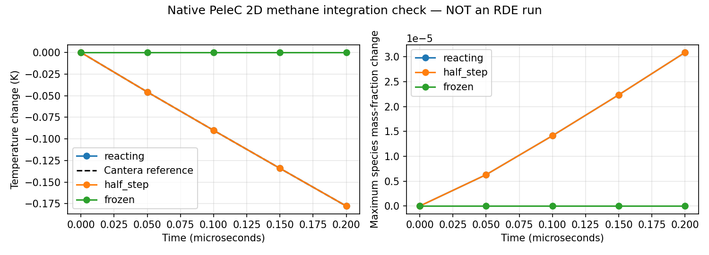

# PeleC 2D P1 integration evidence — 2026-10-25

**P1 passed. This is a chemistry integration control, not a detonation or engine.**
P0 selection was published as `1868f8b`; the preserved custom solver baseline is
`73d4516`. [Selection and next gates](../../plans/pelec_2d_transition.md).
[Installation and reproduction](../../../cfd/pelec/README.md).

## What actually ran

Built pinned native PeleC/PelePhysics/SUNDIALS in Modal, explicitly 2D, double
precision, CPU, no MPI/OpenMP. Only the upstream problem initializer/build
registration was adapted. No numerical, kinetic or thermodynamic source patches.
The full 53-species grimech30 mechanism is compiled into the executable. Native
species, energy, EOS and chemistry are used together; the original one-step
source is not part of this executable.

Uniform periodic 8x8 grid, 1x1 mm domain, CH4:O2 molar ratio 1.176:2,
1800 K and 377916.972 Pa, evolved to 0.2 microseconds. Hydro enabled, diffusion
disabled. Reacting timestep 10 ns, half-step 5 ns, and frozen timestep 10 ns.
CVODE GMRES, relative tolerance 1e-11, absolute tolerance 1e-22. Independent
Cantera 3.2.0 uses the exact bundled mechanism and tighter reactor tolerances.
Five saved times per case are compared. This short interval checks active early
chemistry, not ignition delay or the complete heat-release history.

| Check | Largest observed discrepancy |
| --- | ---: |
| Temperature vs Cantera, relative | 1.72e-10 |
| Pressure vs Cantera, relative | 1.08e-10 |
| Species vs Cantera, absolute mass fraction | 1.84e-10 |
| Half-step final species difference | 2.56e-15 |
| Density drift, relative | 3.78e-15 |
| Total-energy drift, normalized | 0 at saved precision |
| Element mass-fraction drift | 1.00e-15 |
| Species-sum error | 3.34e-16 |

All execution, finite-field, dimensions, time-window, species-order, provenance,
conservation, uniformity and reference checks pass. Frozen chemistry remains
unchanged. Reacting maximum species change is about 3.09e-5, so a disabled source
cannot pass. Temperature falls about 0.178 K: the independent mechanism agrees
with this early endothermic interval. It is not evidence that a wave dies out.

Detailed tolerances, every comparison, source pins, native initializer hashes,
Python adapter hashes, compiler/packages and executable hash are in
[report.json](report.json). SI field exports are the three adjacent NPZ files.
The native archive checksum is in [native_execution.json](native_execution.json).
Full native logs/plotfiles remain locally in `runs_cfd/pelec_p1_02` (ignored).
Raw archive SHA256:
`a5072874415d1bb729401e89383eb04fcc4185a024f3f291ebbd01f4b652562e`.

## Runtime and resources

Build: 157.44 s using a 16-CPU, 32-GiB build allocation (8 compiler jobs).
One 2-CPU/4-GiB run container: reacting 3.24 s, half-step 4.87 s, frozen 0.17 s,
including native launch/output. No GPU or persistent deployment. These tiny
control timings do not estimate engine runtime or establish a one-hour target.

## Failures encountered and corrected

- Local dependency resolution attempted a Rust build of newer cbor2. Pinning
  the available 5.6.5 wheel avoided extra toolchain installation. Separate
  `.tooling/pelec-venv` leaves the original `.venv` unchanged.
- First Modal image build could not import its build helper. Place that helper
  on the image's Python import path (`/root/build.py`). No CFD ran in that attempt.
- First native batch completed both reacting cases but the frozen case exited
  nonzero because strict unused-input checks rejected inactive CVODE settings.
  Keep strict checking and omit those settings only when chemistry is disabled.
  [Initial failed execution](initial_failed_execution.json) is retained; the
  initial analysis correctly failed that batch despite correct physical fields.
  Raw failed evidence remains in `runs_cfd/pelec_p1_01`.
- Corrected batch repeats all three controls and independently analyzes them;
  it passes without changing rates, tolerances or physical parameters.

## Software verification and scope

Nine adapter regression tests pass, including deliberately disabled chemistry,
printed CVODE failure despite an otherwise successful process, incomplete time,
corrupt species/energy/elements, incorrect dimensions, and archive integrity/path
checks. Five original physics tests also pass. Logs are adjacent. This is a
focused increment; the entire historical suite was not rerun. Original solver
files are unchanged relative to `73d4516`.

P2 is next: verify mechanism and inverse thermodynamics over hot shocked/product
states, then a planar propagation control with spatial and temporal checks.
The pinned GRI inverse extrapolates above 3000 K; no diagnostic temperature-bound
patch from the separate 3D work was copied. P1 restricts acceptance below 2500 K.
The mechanism has not yet been accepted for high-temperature CH4/O2 detonation.
P3 remains the periodic engine, injection/outlet/launch inputs and multispecies
report/GIF adapter. GPU execution and engine performance remain unmeasured.
RDE-001 stays open. No sustained-wave claim follows from this integration pass.
