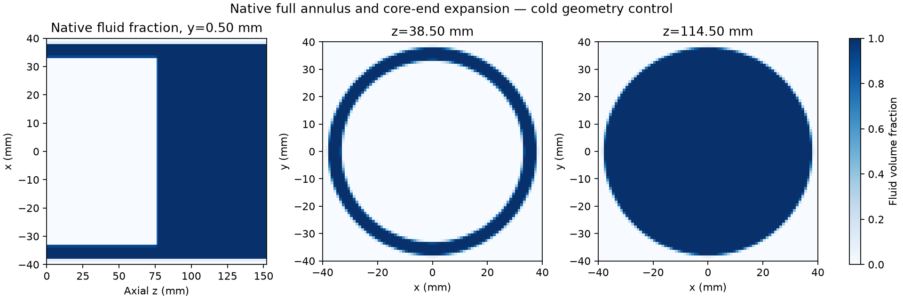
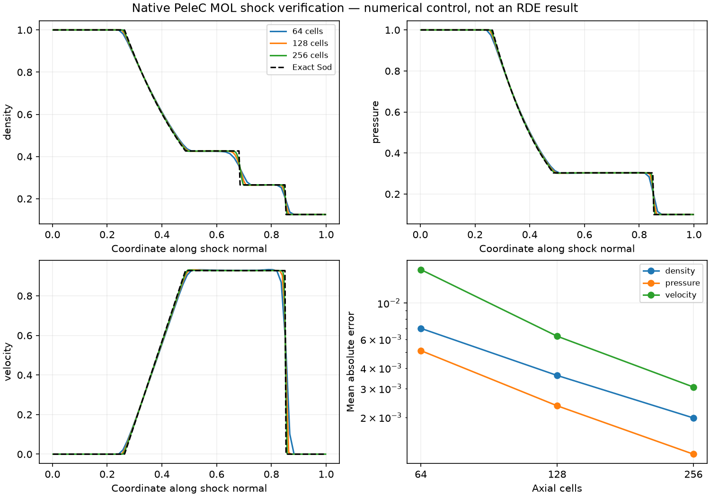

# Native geometry/cold controls and MOL extension

**The geometric and static-equilibrium subset passes. Full G1b is still open:**
moving shocks at cut cells, local repair/correction accounting and the subsequent
AMR/refinement-interface checks are not certified by a static state. No engine or
methane result is inferred from these cold controls.

The existing native parser represents the full annulus and finite core directly:
outer radius 38.1 mm, inner radius 33.1 mm, core length 76.2 mm, outer length 152 mm.
The implicit function uses positive solid / negative fluid; it combines the outer
cylinder with the finite inner core. It needs no custom geometry CFD method.
Cartesian isotropic grids are 80×80×152 (1 mm) and 160×160×304 (0.5 mm), spanning
±40 mm in x/y and 0–152 mm in z. Initial/final native fields, not reconstructed
meshes or images, provide the volume and topology checks.

| Quantity | 1 mm grid | 0.5 mm grid |
|---|---:|---:|
| Volume relative error | 6.643e-5 | 8.362e-6 |
| Largest actual boundary-area relative error | 1.401e-4 | 3.562e-5 |
| Integrated absolute slice-area error / volume | 1.179e-4 | 3.381e-5 |
| Largest individual slice-area relative error | 0.002862 | 0.003336 |
| Connected fluid regions | 1 | 1 |
| Cut cells | 70,752 | 280,948 |

All actual surface-area errors decrease. The largest slice error stays localized
at the core-end cut layer; the core occupies 0.2 versus 0.4 of that layer's height.
Its nonmonotonic maximum is consistent with a sharp-corner/grid-phase effect,
not time accumulation: the integrated error improves and the cold state remains
unchanged. This is not a demonstrated maximum-norm convergence result. Both maxima
satisfy the predeclared 1% geometry threshold. Retain the observation when checking
moving waves and future core-end refinement; do not hide it behind total volume.

The closed GammaLaw cold state is a normalized numerical control, **not 300 K
methane**. Ten MOL steps preserve mass, total energy and single-species mass with
zero measured integrated drift. Maximum density/pressure/temperature differences
are <3.5e-15 relative; velocity is <4.5e-19 m/s. Species clipping is explicitly
disabled in this control. Both domains have the correct interior/solid signs,
positive fluid states and one connected fluid region. The base H100 runs take
2.90 and 6.58 s, excluding cloud queue/image build. They are not reacting-engine
throughput estimates.

## Actual wall-flux geometry, not visual inference

A copied upstream Sod case adds only a read-only `problem_post_init` hook. It
exports PeleC's actual sparse `EBBndryGeom` records, excluding ghost-cell duplicates,
and native axial face apertures. The numerical source and physics are unchanged.
The separate build took 73.88 s; its binary/source hashes are saved.

Source review matters here: `EB.cpp` stores the normal proportional to open-high
face minus open-low face. `MOL.cpp` uses the negative of that normal in the pressure
flux. Thus the stored vector points into fluid; the analyzer explicitly converts
it to physical outward orientation. This is a convention conversion, not a solver
normal repair. We verify unique owned records, unit normals, expected radial/core
orientation, positive areas and correct port areas. At the core corner, radial
and axial projections separate inner-wall and end-face contributions.

Surface-vector closure is <6.4e-15 relative. The divergence-theorem volume matches
native volume fractions to <6.1e-14 relative. The read-only hook also preserves the
same cold-state checks. Raw CSV/plotfiles remain in ignored run artifacts; compact
checks, commands, build hashes and reviewed plots are committed.

## Hydro-method gap found and closed for regular-grid controls

The original G1a shock cases used native Godunov hydro. Embedded-wall runs use
native MOL, so those passes could not alone certify this other path. Seven new
MOL controls cover 64/128/256 axial cells, timestep halving at 128, all three
Cartesian directions, and a same-case serial CPU comparison. They reuse the
upstream Sod initializer and existing exact reference.

Density/pressure/velocity mean absolute errors decrease on all three grids;
finest errors are 0.001983 / 0.001191 / 0.003065. Timestep differences are <10% of
same-grid spatial error. CPU/GPU relative differences are <3.7e-15, and rotated-axis
differences <1.7e-15, with transverse invariance, positivity, mass/energy and the
pressure-impulse momentum check passing. This is not a formal smooth-order claim
for discontinuous shocks and does not yet verify moving cut-cell fluxes.

Reproduce with `modal_controls.py --suite shock --hydro-method mol --directions`,
collect using the existing checksum verifier, and run `analyze_mol_shocks.py` on
its `controls` directory. The original Godunov/hydrogen defaults remain available.
For geometry, run `modal_geometry.py --nx 80 --output NEW_JSON` (or 160), then
`analyze_geometry.py RUN`. Set `PELEC_GEOMETRY_DIAGNOSTICS=1` for the native surface
hook, and also run `analyze_geometry_surfaces.py RUN`.

The small geometry/methane launchers now cap queue plus startup/execution at
600 seconds after the separately bounded image build, using Modal's documented
`spawn/get(timeout)/cancel` API. A deadline cancels only that call, records failure
and makes no artifact/validation claim. Solver subprocess caps still preserve
partial artifacts when they expire first. No paid timeout was deliberately forced.

