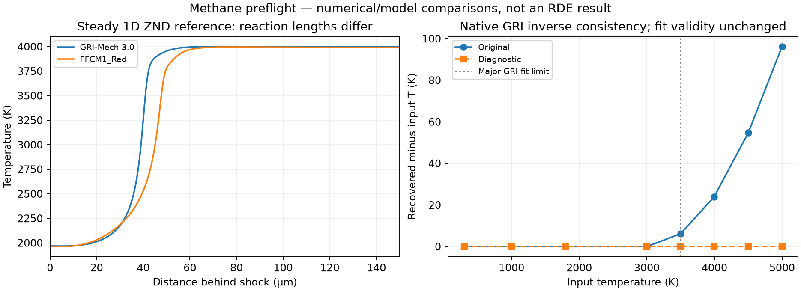

# G2 methane preflight — numerical issue isolated; physical model gate open

No methane propagation or 3D engine result is accepted. G0/G1a remain passed.
The current experiment is a native GRI closed-reactor control of an explicitly
declared thermochemical law. A successful numerical test will not close the
outside-fit thermochemistry, geometry, propagation or sustained-wave gates.

## Mechanism decision

Keep full GRI-Mech 3.0 (53 species, 325 reactions) as the paper-comparison baseline
for now. Do not adopt FFCM1_Red (21 species, 124 reactions) merely because it is
smaller or its CJ speed agrees. These are independent Cantera/SDToolbox results,
not native CFD or experimental validation:

| Quantity, same phi 1.176 / 300 K / inferred prefill 377916.972 Pa | GRI | FFCM1_Red |
|---|---:|---:|
| CJ speed, m/s | 2531.8614 | 2530.8131 |
| CJ temperature, K | 3994.1357 | 3988.4217 |
| ZND induction time, ns | 134.4000 | 149.4120 |
| Half-heat-release length, micrometres | 39.5220 | 45.7689 |

Both ZND references pass the inherited 0.1% invariant criterion. Refinement changes
induction time by <1.2e-7 relative; half-heat distances are stable. Energy residuals
remain about 6.8e-5, not the much smaller closed-reactor residual. The recorded
SciPy overflow warning occurs during strict internal integration work; the
integration completes, states and invariants are checked, and the warning is not
silently erased. Factor-29 cell-size estimates remain empirical proxies.

A broader constant-volume screen rejects equivalence for ignition classification:
at 1001 K and the model VN pressure (~22.9843 MPa), GRI reaches a +400 K rise in
about 1.295 ms, while FFCM1_Red does not within 2 ms. At 1500 K / inferred prefill
pressure FFCM1_Red ignites ~28% earlier; at 1968 K / that pressure it ignites ~28%
later. This is a difference between models, **not proof that either predicts the
experiment correctly**. Two integration tolerances/step limits retain the results;
maximum crossing-time change is 5.2e-7 relative, energy error 2.4e-11 and element
error 1.1e-14. Null event times mean no crossing within this window, not an infinite
ignition delay. Exact state, bracketing interval and tolerance are saved.

The full FFCM1 authors document high-pressure/high-oxygen limitations associated
with missing CH3O2 chemistry; FFCM1_Red also lacks H2O2. These are hypotheses relevant
to model suitability, not a proven root cause of this particular discrepancy.
GRI is likewise not a truth model at all these conditions. See the authors'
[FFCM1 description](https://web.stanford.edu/group/haiwanglab/FFCM1/pages/FFCM1.html)
and [FFCM2 comparison](https://web.stanford.edu/group/haiwanglab/FFCM2/docs/TrialModel/PreliminaryTest/).
A broad mechanism-generation/reduction project is not part of this first increment.

## Native thermodynamic inconsistency and diagnostic correction

The pinned DRM19/GRI generated `GET_T_GIVEN_EY/HY` switches to linear inverse
extrapolation above 3000 K. Forward u/h/cv/cp still evaluate the NASA polynomials.
At the GRI CJ temperature, fresh/product energy inversions miss temperature by
about 30/24 K and energy by 0.75/0.60%. This is a local algebraic inconsistency,
not cell size, time accumulation or GPU error. The EOS wrapper ignores the inverse
status, so a zero solver exit code would not detect it.

The explicit diagnostic changes only the two GRI inverse upper bounds from 3000
to 5000 K, allowing the existing Newton method to invert the existing forward law.
Original/patched SHA256 and exact replacement text are saved. No rate, species,
thermo coefficient, grid or reaction-zone width is fitted or altered. The pinned
local upstream checkout remains unchanged; the build overlay is separate.

Both energy and enthalpy round trips pass the original numerical thresholds on
fresh/equilibrium states from 300 to 5000 K, with an independent 1000 K initial
guess. Forward thermodynamics match Cantera. Every GRI species has positive cv
through 300–5000 K: each NASA7 polynomial is checked at its endpoints and derivative
roots, not just at a few sampled temperatures. This establishes monotonic energy
on each interval, not continuity at every fit join or high-temperature accuracy.

**Published fit limits are unchanged.** Major GRI fits end at 3500 K (the minimum
upper bound across species is 3000 K). The CJ state is outside them. Accordingly
`numerical_consistency_passed=true` but `operator_preflight_passed=false` for the
diagnostic. A regression test ensures that a numerical correction cannot silently
pass the physical fit gate. GRI outside-fit extrapolation is a declared reference
model assumption, not a validated production choice. Before design predictions,
compare defensible high-temperature thermochemistry and ignition-model sensitivity
at the actual relevant states, then validate propagation and experiment.

FFCM1_Red passed the earlier 300–4500 K operator screen. The expanded 5000 K endpoint
probe flags its native status at the fit boundary because the equilibrium state
lands fractionally beyond it in floating point; temperature/energy errors remain
small. This is recorded separately from its material ignition-model discrepancy.

## Paper CJ discrepancy

GRI at 1 atm gives 2472.259 m/s, near Mundt Table 3-2's 2471 m/s; at Eq.4.1 inferred
prefill pressure it gives 2531.861 m/s. This identifies pressure basis as a plausible
major explanation of the earlier 2.46% discrepancy. It is **not resolved**: the
paper's precise Table 3-2 inputs were not recovered, and Chapter 4 describes the
inferred pressure for its CJ calculations. Preserve both references; do not choose
pressure to fit the reported speed or substitute chamber mean pressure.

## Reproduction and failures retained

Run `tools/pelec/methane_preflight.py NEW_OUTPUT --znd` with the isolated analysis
environment. It reuses the pinned SDToolbox `_cj`/`_znd`; the only starter change is
an optional mechanism argument, leaving the default GRI reference unchanged.
Five inherited reference unit tests passed before this integration. The first new
wrapper reused a Cantera phase mutated by ZND and failed the strict-run peak check.
The fix resets the phase to the saved frozen postshock state before each run.
The failed output remains in ignored `runs3d/methane_preflight_repro`; successful
reproduction is `methane_preflight_repro_02`. Do not reuse the failed strict output.

Run `modal_thermo_audit.py --states STATES --output NEW_JSON` for the original
operators, then `--gri-inverse-bound 5000` for the explicit diagnostic. Use
`analyze_thermo_audit.py EVIDENCE REPORT` for numerical and fit-range checks. The
committed evidence includes exact compositions, native values, source hashes and
compile commands; full ZND arrays remain in ignored run artifacts.

A small postshock, constant-volume GRI reference to 0.5 microseconds passes its
own tolerance refinement, energy, element, density and species checks; maximum
T is 4640.676 K. It therefore stays inside the **declared polynomial interval**,
while remaining outside published fit ranges. The native control may now test
that law's integration. It is not an engine ignition or sustained-detonation test.

## Native methane numerical controls passed

The explicit GRI polynomial-law reactor now passes on the native CPU and H100
executables. It evolves 512 uniform cells for 0.5 us, with hydro disabled; it does
not model a detonation front or an engine. The build took 303.6 s and is cached as
`im-MxDWVRIolNfv3gkXQzmtPz`; source/overlay/binary hashes are saved.

| Native control | Outer step | rtol / atol | Solver wall time | Maximum all-step T error vs generated-law reference |
|---|---:|---:|---:|---:|
| H100 | 5 ns | 1e-11 / 1e-22 | 18.22 s | 2.64e-10 |
| Serial CPU | 5 ns | 1e-11 / 1e-22 | 155.16 s | 2.59e-10 |
| H100 step halving | 2.5 ns | 1e-11 / 1e-22 | 21.74 s | 2.02e-9 |
| H100 tolerance check | 5 ns | 1e-10 / 1e-20 | 15.43 s | 3.39e-9 |

All runs pass peak-species, finite/positive-state, energy, element, density,
species-sum and uniformity checks. CPU/GPU common-field maximum differences are
4.96e-12 relative T and 8.42e-12 absolute Y. Timestep/tolerance comparisons also
stay well within the existing 2e-5 T/P and 2e-6 species error budgets. Halving the
outer step does not produce monotonic error at this tiny level; do not infer a
formal spatial or hydrodynamic order from a homogeneous reactor.

The same generated Rcal/reference-concentration conventions found in LiDryer also
apply to GRI. Compiled source rates across 300–5000 K fresh/equilibrium samples
agree with the source-derived independent model to 3.71e-14 normalized. The
nominal-YAML temperature comparison instead has a 1.076e-4 peak relative difference
and is explicitly retained as a **failed nominal-identity check**, not called
integration error. No constants were fitted to trajectories.

The original field subsampling selected different physical times for the two
outer timesteps; the comparison guard rejected only seven shared samples. We
re-read additional common saved times, preserving the original analyses and
obtaining sixteen shared samples including the heating interval. No CFD rerun or
tolerance relaxation was needed. Hydrogen control reanalysis still passes after
the shared harness extension. The reference test invocation initially used the
wrong working directory and failed import; from `rde_sim_starter/`, all five tests
pass in 3.272 s. Sixteen fast 3D tests pass.

The measured ~8.5x difference is one H100 versus the **serial** CPU binary on this
small control. The control allocation reserves a GPU even for CPU execution, so
it is not a CPU-only cost comparison. It does not predict a full annular engine's
throughput, optimized MPI performance, or multi-GPU scaling. The 1–2 hour engine
requirement remains unmeasured.

## Refined thermodynamic sensitivity and provisional propagation scope

Retaining all 53 GRI species and 325 forward reactions, substitute the available
common-species thermodynamic polynomials from pinned FFCM1_Red in an independent
reference only. Reverse rates change through thermodynamics. The 24-state direct
forward-rate comparison differs by at most 2.86e-14; serialized coefficient
roundoff is recorded. An initial exact-dictionary check rejected harmless YAML
unit-conversion roundoff (about 1e-16). It was replaced by a strict structural and
numeric check plus the direct operator comparison, not a chemistry retuning.

CJ speed changes -0.0436%, CJ temperature -0.144%, induction time -3.053%, and
half-heat-release distance -3.265%. Baseline/strict ZND refinement changes those
length/time diagnostics by <4e-6 relative, far below the model sensitivity.
Existing ZND energy/momentum residual gates pass. Internal SciPy overflow warnings
are retained in logs; no failed integration is accepted.

This is useful sensitivity evidence, **not a physical uncertainty bound**. The
alternative still has up to 1.90% of mixture mass outside published species-fit
ranges along the ZND profile; minor species can have important kinetic effects.
GRI itself remains substantially outside its published high-temperature fits.
No alternative thermodynamics were installed in native CFD.

Decision: permit a bounded, formed-wave numerical propagation check of the
explicit GRI polynomial law, using the already audited inverse interval, before
building an engine. Keep full GRI initially to avoid conflating a solver change
with an unverified reduced chemistry change. This conditional numerical check
cannot pass the physical/design gate or establish experimental sustainability.
For design conclusions, retain mechanism/thermo and boundary sensitivities and
positive/negative experimental controls; changes in wave classification block a
single verdict. Do not claim that agreement with an extrapolated reference
validates the extrapolation itself.

Reproduce with `thermo_sensitivity.py NEW_OUTPUT_DIRECTORY`. Evidence is in
`thermo_sensitivity/`; raw profiles and failed serialization trials remain in
ignored run artifacts.
