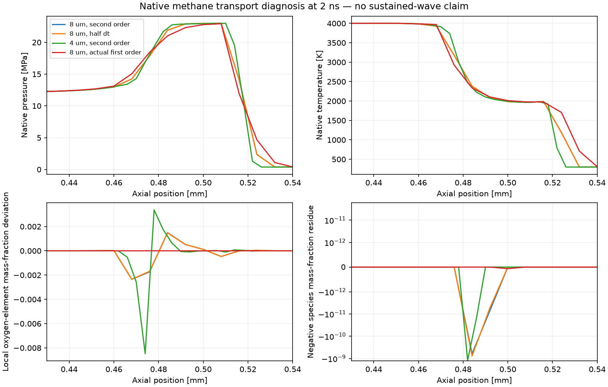
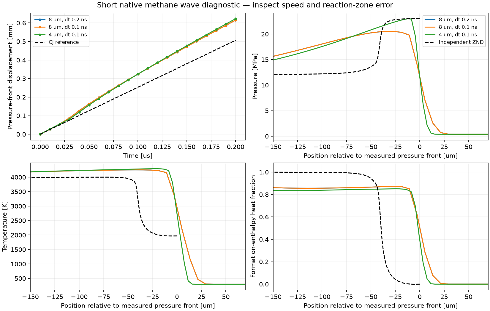

# Native formed-wave initialization and transport diagnosis

**G2b is not passed. The propagation controls fail.** The initial cell-average
import passes. A snapshot-only first-order probe appeared to pass, but the later
every-step audit detects a transient negative species value; its status is corrected
below and the original report is preserved. This is not evidence of a
sustained planar detonation, much less a rotating engine wave. Longer-window,
mesh/timestep, wave-speed/reaction-distance and open-boundary budget checks remain.

The native initializer is the only new C++ case code. All evolved physics is
pinned PeleC/PelePhysics. Full GRI chemistry, source-derived generated constants,
FP64, native MOL/CVODE, the documented 5000 K inverse interval, and no continuing
ignition are used. A 2.048 mm domain starts with a right-moving independent ZND
wave at x=0.512 mm; 256/512 x cells give 8/4 um spacing, with 8×8 uniform periodic
transverse cells. Ends use native first-order extrapolation. The short reaction
window is initially outside the boundary characteristic cones; this is checked,
not permission to extend indefinitely with the same domain.

## Watch the saved propagation

[Wave motion](animations/wave_propagation.gif) and
[reaction-zone close-up](animations/reaction_structure.gif) replay the fine-grid
control below. Each has 21 native snapshots, fixed scales and printed physical
time, without temporal interpolation. The motion view displays transverse-mean
strips, not annular geometry. The reference front/profile are independent; both
movies retain the failed propagation status.
[Launch and replay instructions](../../../tools/pelec/QUICKSTART.md) and
[source manifest](animations/manifest.json) accompany the movies.

## Initialization issues found and fixed

- The first tightened ZND profile still contained a -2.54e-12 trace-species
  residue. Tightening the absolute integration tolerance from 2e-12 to 1e-14
  reduced the subsequent bounded cleanup to 4.00e-14. No native field clipping
  was introduced and the original failed reference is preserved.
- Four/eight-point cell quadrature differed by 1.29e-4 in the coarse profile's
  worst normalized species L1 diagnostic. Exact integration of the independently
  computed piecewise-linear **conserved** profile replaces quadrature. Domain
  integral errors are 2.50e-14 / 1.53e-13. This does not make the spatial CFD
  solution exact; the profile interpolation and CFD resolution remain separate.
- Native initial conserved fields agree with the imported averages to <3.3e-17
  relative L1. CGS/SI conversions and shock placement are checked in native data.
- A launch-bound equality rejected 2e-10 versus floating-point 8e-6/40000; a
  1e-12 relative comparison allowance fixes only roundoff, not the timestep.

## Transport root-cause controls

All rows below cover the same physical 2 ns interval. The elemental quantity is
the largest **local mass-fraction deviation** from the uniform premixed elemental
composition; it is distinct from a global conservation defect.

| Native control, saved 2 ns field | Smallest species Y | Maximum local elemental deviation |
|---|---:|---:|
| Second-order, 8 um | -6.13e-10 | 0.002350 |
| Same grid, timestep halved | -7.77e-10 | 0.002342 |
| Second-order, 4 um | -1.22e-9 | 0.008474 |
| Chemistry disabled, 8 um | -4.55e-10 | 0.002711 |
| Actual first-order, reacting, 8 um | -6.38e-14 | 5.74e-14 |

The original strict species/local-composition gates are retained. Total elemental
mass ratios stay within 8e-15 in the measured controls: the local deviations are
not evidence of globally created atoms. Timestep halving does not cure them,
chemistry removal reproduces them, and changing actual spatial reconstruction
removes them. Source inspection shows independently limited characteristic
species slopes in `MOL.H`/`MOL.cpp`; these can alter local elemental ratios even
with conservative species fluxes. The finer-grid maximum gets worse for this
profile, so do not claim this defect is converged or will disappear automatically.

A configuration trap was also measured: setting `mol_iorder=1` alone leaves the
solution unchanged to roundoff, because pinned `Diffusion.cpp` passes
**`plm_iorder`** to the MOL flux routine. Both are now explicit. No custom flux or
upstream solver repair was written. First-order is only the simplest native
candidate for a subsequent accuracy check; its additional diffusion can itself
cause false decay or alter reaction coupling.

The first-order probe's saved fields pass species sum, EOS pressure/energy,
transverse invariance and boundary-cone checks. These snapshots alone do not
pass the subsequently added every-step positivity check. Energy consistency is 1.69e-10;
transverse velocity is zero. It takes 4.85 s on one H100, including native startup
but excluding cloud queue/build. The native initializer build took 107.56 s.
These numbers do not predict full-engine runtime or establish CPU/GPU scaling.

## Failed infrastructure/configuration attempts are retained

A frozen-control attempt reached its final time but failed strict unused-input
checking because CVODE tolerances were still supplied while reactions were off.
It is marked failed. Removing only those inactive inputs allows clean completion;
the transport defects remain. A report initially failed on NumPy boolean JSON
serialization; converting check values to ordinary booleans fixes the report,
without rerunning or changing the solver. One first-order launch lost its local
Modal connection. App listing confirmed it stopped with zero tasks before one
repeat. New launches save their function-call ID before waiting, enabling recovery;
probe queue/startup/execution is bounded to 600 s, separately from image building.

Raw native fields and unsuccessful attempts are retained under ignored `runs3d`
and the task's temporary logs. Compact commands, reports and source/binary hashes
are committed here. Reproduce a fresh reference with `prepare_wave.py NEW_DIR`,
then run `modal_wave.py` with its case/profile paths, collect through the existing
checksum verifier, and call `analyze_wave.py RUN_DIR REFERENCE_DIR`. The default
`--reconstruction-order 1` selects the documented diagnostic candidate; use 2 only
for the explicitly failed higher-order diagnostic. Keep all
longer runs bounded and never interpret mere final-time completion as a pass.

## P3D-001 — failed propagation despite plausible moving pressure fronts

Three native controls reached 0.2 us. They cover only 1.49 reference induction
times, so even passing them would not prove sustained operation. None passes.
The reference CJ speed is 2531.861 m/s and half-heat distance is 39.521 um.

| dx | dt | Native seconds | Fitted speed, central pressure threshold | Speed error | Median apparent half-heat distance |
|---|---|---:|---:|---:|---:|
| 8 um | 0.2 ns | 332.12 | 2902.866 m/s | +14.65% | approximately zero, unresolved |
| 8 um | 0.1 ns | 457.14 | 2902.917 m/s | +14.65% | approximately zero, unresolved |
| 4 um | 0.1 ns | 539.76 | 2981.938 m/s | +17.78% | 1.58 um, below one cell |

Halving the timestep changes the central fitted speed by only 0.051 m/s; halving
the cells does not recover the reference. Three pressure thresholds give the
same qualitative finding. The pressure/reaction structure is not resolved: the
heat-release rise lies inside the spread pressure front. A positive bounded
shock/reaction distance alone is insufficient; the analyzer now also explicitly
requires reaction-distance accuracy (20%). The existing speed check is 5%. No
failed result was changed into a pass by adding this stricter structural check.

Mass/energy changes match an independent boundary-cell flux integral with
normalized residuals <3e-14 / <2e-11. Halving the snapshot quadrature density
changes energy balance by <6e-11. This is a separately qualified snapshot
diagnostic, not an exact native flux ledger or an EB-repair accounting pass. It
does not support unexplained energy creation as the cause of the excessive speed.

The full-precision saved fields preserve elemental composition to about 3e-13.
However, checking **every logged timestep** finds a -4.09e-11 species value at
0.4 ns in both the original first-order probe and the longer coarse run; the
halved-step case reaches -6.05e-11. These exceed the existing 1e-12 trace threshold.
The snapshot-only pass is therefore withdrawn. The 4 um run passes every-step
state extrema, but fails speed/structure accuracy and the conservative left
buffer check: the observed maximum characteristic speed exceeds the planning
estimate, giving a -19.7 um margin for the prescribed 200 um inspection window.
That does not prove boundary contamination; it means exclusion has not passed.
A longer left buffer is required before accepting this comparison.

The diagnostic failure is independent of engine geometry, injectors, wall losses
or sustained forcing, since those are absent here. Timestep reduction does not
explain it, and initialization/EOS/chemical-source and global balance controls do
not reveal a discrepancy large enough to explain the speed. Spatial smearing
coupled to stiff reactions is a strong candidate, **not a fully isolated final
cause**. Short-window physical instability and the fine-case buffer limitation
still need to be distinguished. Do not label this numerical state a sustained
wave or infer anything about a modified engine's stability.

[LeVeque and Yee's NASA report](https://ntrs.nasa.gov/api/citations/19880008959/downloads/19880008959.pdf)
shows how a smeared advective state can activate a stiff source and move a front
at the wrong speed, even when the source treatment is stable.
[Yee et al., ICCFD7 (2012), sections 1, 4 and 5](https://www.iccfd.org/iccfd7/assets/pdf/papers/ICCFD7-1804_paper.pdf)
show that ordinary convective CFL bounds and nominal high order do not guarantee
correct reactive propagation; grid/timestep behavior can be nonmonotonic. These
are general mechanism warnings, not proof about this PeleC/GRI configuration. No
randomized chemistry, reaction suppression, or custom flux method was added.

### Decision and next bounded work

Keep the full GRI setup as a verification reference; measured small-case cost
does not support it as a two-hour full-engine recipe. Do not promote first-order
MOL to production because its endpoint fields looked clean. First repair the
control-domain buffer, then compare one existing native higher-order transport
option on the same planar reference, with every-step checks and the same physics.
A regular-grid Godunov comparison can isolate a MOL limitation but cannot certify
embedded-boundary geometry. If an acceptable path requires substantial solver
repair, use the installed detonationFoam fallback for a bounded equivalent
control, not a second complete engine stack. An engine launch remains blocked
by G2b plus the independent dynamic EB/AMR and model gates.

Nineteen fast tests pass, including regression cases for a transient failure
between good endpoints, incomplete logs and nonfinite histories. Raw failures
remain available. All three paid runs completed within their caps; no engine
run was launched.

