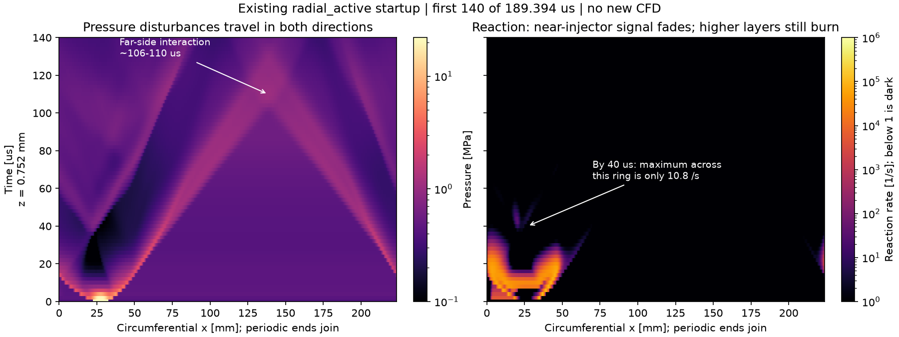

# Startup, opposing fronts and the apparent cancellation in the GIFs

October 22, 2026. Read-only review of the original `radial_active` hot-patch case,
Mundt's thesis and its collision reference. No CFD, chemistry, injection, startup
or solver parameters changed. **RDE-001 remains open.**

## Finding

The GIF does contain pressure disturbances traveling in both circumferential
directions, with a later far-side interaction. However, near the injector their
strong accompanying reaction has already faded well before that interaction.
The evidence does not support two healthy, equal detonations simply cancelling
as the sole explanation for the initial loss of coupling. It also does not establish
that the startup prescription is adequate, or that later reinitiation is impossible.
The images show an unsuccessful short startup attempt, not a validated engine
that operated steadily and then exhausted its fuel.



## What the native fields establish

All 96 frames, from 0 to 189.393939 us, were read with the native-prefix and field
validators. The plots show the first 140 us; the JSON retains the entire saved
interval. Circumferential position is periodic; a line leaving x=0 continues at
x=223.681 mm. Two opposing slopes, their convergence and later outgoing pressure
signals are present. There is no imposed travel speed or camera rotation.

At the ring z=0.751974 mm:

| Time | Pressure observation | Reaction observation |
|---|---|---|
| 10 us | Two peaks at x=4.754 and 44.786 mm; 2.326 and 3.156 MPa | Maximum rate within 2 mm of each peak: 56,004 and 49,347 /s |
| 20 us | Peaks at x=53.794 and 219.928 mm, still well separated | Within 2 mm, rates are about 34–35 /s; widening to 8 mm includes strong reaction, so this narrow-window measure alone does not establish extinction |
| 40 us | Peaks at x=69.807 and 205.417 mm, 1.761 and 1.477 MPa; no far-side meeting yet | **Maximum rate anywhere on this entire ring is only 10.772 /s**; within 2/4/8 mm of those peaks, at most 1.284 and 0.615 /s |
| About 106–110 us | A merged far-side peak forms near x=138 mm; at 110 us it reaches 1.065 MPa | Rate within 2/4/8 mm is only 0.0635 /s; whole-ring maximum 0.332 /s |

These are saved pressure peaks and reaction rates, not verified detonation fronts
or reaction-zone lengths. The far-side interaction is identified from converging
pressure traces and profiles, to the 2 us output cadence. It is not the first
interaction anywhere in the 2D flow: startup reflections and axial interactions
also occur. The prominent interaction occurs earlier at some greater heights.
No identity is extrapolated through the merger. The transient pressure rise is
inconsistent with interpreting the encounter as literal pressure/energy cancellation.

The early 20 us result is window-sensitive: cells above 1000 /s lie only
3.50–4.50 mm from the pressure peaks. That prompted the 4/8 mm sensitivity check
and the use of the stronger **40 us whole-ring** evidence for the ordering argument.
At 40 us, other heights still burn strongly. At z=7.770 mm the ring maximum is
about 88,739 /s, and the full fields show an extended reacting fresh/product
interface. Thus near-injector loss is not all-domain chemical extinction.

See [three-height pressure/reaction maps](startup_collision/rings.png),
[lower-chamber fields and pressure profiles](startup_collision/profiles.png),
and [all frame metrics, definitions and hashes](startup_collision/metrics.json).
The earlier [native fuel audit](propagation_gifs.md) shows continuous replenishment
and growing unreacted inventory. Fuel supply is not globally exhausted.

## What Mundt actually shows

Printed pages below refer to [Mundt2023.pdf](../../Mundt2023.pdf); PDF page is
printed page + 16. The complete relevant pages were rendered and inspected.

- **p.26, Figure 2.3:** a spark-fired predetonator enters through a radial port.
  Example frames are at 0, 46, 133 and 225 us, then 0.75 s. The early sequence
  expands across the chamber and becomes broadly luminous; it is not a clean,
  fully established rotating front from the first instant. This is an example
  ignition of a 76 mm engine, not explicitly identified as Run 937.
- **pp.47–52, Figures 3.4–3.7 and Table 3-2:** Run 937 has two **co-rotating**
  waves, no reported counter-rotation, 15.84 kHz passage frequency and a 0.696 s
  burn. Its late x–t image has repeated parallel diagonal streaks. In an unwrapped
  physical field, the fronts should move sideways, wrap through the periodic
  seam and repeat, with axial product exhaust and oblique structures behind them.
- **pp.42–43 and Appendix B, pp.171–172:** counter waves can coexist during
  operation; a 51-FI-5 example has strong counter waves and crossing x–t traces.
  These are different operating points, not a license to relabel our startup as
  successful Run 937 replication.
- **p.21, reference [51]:** collisions create pressure/temperature spikes and
  affect injector recovery. The paper does not argue that opposite directions
  automatically extinguish all waves.
- **pp.15–16, 34–35:** injector geometry and mixing affect performance. The stated
  30-degree angle is relative to the combustor axis, with impingement 2.16 mm
  above the face; it is not a specified 30-degree azimuthal swirl angle. Our
  equivalent premixed axial inlet does not resolve those jets. Geometry matters,
  but adding arbitrary tangential momentum would not reproduce this hardware.

Equal and opposite momentum can sum to zero without energy disappearing. These
are nonlinear reactive compression waves, not positive and negative copies of a
linear signal. Collision outcomes depend on reactants, wave strength and recovery.

Mundt reference [51], [Batista et al., AIAA 2021-3659](https://www.researchgate.net/publication/353527772_Detonation_Wave_Collision_Study_During_Rotating_Detonation_Rocket_Engine_Counter-Propagating_Modes),
was checked in the author-uploaded full text. Its introduction describes bidirectional
startup followed by mode selection. Its equal-strength collision analysis finds
amplification followed by recovery, including localized decoupling and recoupling.
Figures 2–3 distinguish sustained counter-propagation from a startup that selects
co-rotation. This supports testing collision effects, not assuming automatic
cancellation or guaranteed survival.

## Videos and supporting material located

[University of Washington's research announcement](https://www.washington.edu/news/2020/02/18/simple-fuel-efficient-rocket-engine/)
links two primary-team recordings:

1. [Experimental startup, Koch/UW](https://www.youtube.com/watch?v=zXSsd7uXjt8).
   The university caption identifies ignition at about **11 seconds of playback**,
   followed by stable pulses. The recordings used a 240,000-frame/s camera.
2. [Wave propagation/dynamics, Koch et al.](https://www.youtube.com/watch?v=gEYFy3qRNdo).
   The university caption describes subsequent combustion pulses and merging.

The embedded YouTube players could not be fetched in this environment. These are
verified links and source captions, **not a claim to have watched the movies**.
The visual comparison above uses Mundt's rendered camera frames/x–t figures and
our actual saved fields. No verified public Run 937 raw movie was located. The
thesis's Appendix B is accessible supporting visual evidence, not a video supplement.

An additional [TU Berlin author-deposited dataset](https://zenodo.org/records/18886925)
contains luminosity and pressure records for equal-speed and unequal-speed counter
waves. Its 3.4 GB archive was not downloaded. It independently shows that such
modes are observed, but supplies no validation of our particular simulation.

## Duration and what success should look like

The saved cadence is **2 us**, adequate to show large-scale propagation and this
ordering, although insufficient to resolve every collision/chemical detail.
The total duration is only **189.394 us**. At Run 937's reported two-wave mode,
the passage interval is 1/15840 = **63.131 us**, while one wave's full revolution
is twice that: **126.263 us**. The movie spans three reference passages, only
**1.5 reference revolutions**. These are experimental reference scales, not measured
rotations of our decaying startup disturbances.

Consequently, the development cap cannot demonstrate long-time extinction or a
settled mode. Figure 2.3's 225 us startup image makes this especially clear, but
does not prescribe a universal settling time or guarantee our model would recover.
The already documented loss of reaction support is a physical-model warning even
within this short interval; extending identical inputs alone is not a demonstrated
fix. Optical luminosity is also not the same observable as our computed pressure,
density gradient or reaction rate; direct pixel matching would be inappropriate.

For sustained Run 937-like operation, seek repeated co-rotating fronts crossing
newly replenished reactants, persistent shock/reaction association through several
actual returns, and a stable wave count/speed. Pressure tracks alone, initial blast
survival, and a larger initial fuel charge do not meet that criterion.

## Decision and review of next work

1. **First review — collision hypothesis:** test event ordering before any new CFD.
   The 40 us whole-ring result precedes the ~106–110 us near-injector encounter.
   Retain collision/recovery as a possible later influence; reject cancellation
   as the sole explanation of the initial reaction loss.
2. **Second review — diagnostic limitations:** widen the spatial windows, inspect
   three heights and full 2D fields, and separate cadence from total duration.
   Stronger reaction outside a narrow front window is not missing-data extinction.
   The movie cannot establish the outcome after its stop time.
3. **Third review — avoid redundant studies:** existing main C2/C3 controls start
   with a formed, directional profile and still show a thin-layer limitation.
   The independent sustaining branch additionally reports a 1 mm fresh-layer
   failure without injector/periodic-return complications. That is separate-branch
   evidence, not a result newly implemented or rerun here. Review its chemistry,
   mesh and refill evidence before commissioning another startup-only experiment.

The independent report inspected was `docs/verification/detwave_findings.md` at
branch commit `6875f0270cd2b8652641b97d38e9e2267b075ebb`. It identifies the tested
chemistry/grid versus actual replenished-layer thickness, plus artificial contact
burning, as substantive limitations; it does not claim unique experimental causation.
Its original-chemistry formed-start failure means directional ignition alone is
already an unlikely complete cure. Its shortened-chemistry 80 us Run 937 result
is an incomplete first-transit success, not demonstrated sustained return.

Next physics work should retain the actual-refill-layer gate and a resolved,
physically checked chemical timescale. If a startup comparison is still necessary,
match chemistry, grid, feed and radial closures, explicitly account for changed
initial inventories, and compare through actual returns. Do not add injector swirl,
repeated ignition or artificial layer maintenance merely to select a pleasing movie.
Any later longer-run decision must distinguish a finite development stop from a
physical extinction criterion. No new CFD campaign is launched by this review.

## Verification and reproduction

The existing four analytical peak/direction/collision/cadence tests passed in
0.003 s (test-body time); [test log](startup_collision_checks.txt). They check the
analysis primitives, not engine physics. The audit was executed on all 96 native
frames, and its input/summary/history and snapshot hashes were checked against the
published GIF manifest. An independent raw-array calculation checked the reported
10/20/40/110 us values and the 2/4/8 mm windows. Plots were visually inspected.
No solver changes or new full-suite claim are made.

From the repository root, with the saved run present and a new output directory:

```sh
.venv/bin/python docs/verification/startup_collision_audit.py \
  --run rde_sim_starter/runs/radial_active --out reports/new_startup_collision
```

The script writes metrics and two ring-map figures. `profiles.png` is an additional
inspection montage from the same saved fields, with times and axes printed on it.
